# PiPaper 加法开发规划

> 日期：2026-10-06  
> 当前任务边界：只编写本规划文档，不修改项目代码、配置、数据和依赖，不启动开发。  
> 范围修正：保留现有功能、入口和使用方式，只增加缺失的科研能力。  
> 文档关系：此前的《科研工作平台全流程规划》作为整体参考；本文件作为后续“加法开发”的范围依据。原文档中的全局重构、替换与平台治理项不自动进入开发清单。

## 一、对“加法开发”的具体约定

现有 PiPaper 继续承担文献管理、阅读、对话、研读、选题、检索、写作、视频和资料管理。新增模块从已有成果接收材料，形成新的研究记录，再通过链接或可选操作交给下一环节。

### 1.1 六条执行规则

1. **现有功能继续独立使用。** 用户不建课题档案、不填实验记录，也照常阅读、提问、研读和写作。
2. **已有流程保留。** 不重新安排现有导航，不改默认页面，不把新模块变成旧功能的必经步骤。
3. **已有能力直接复用。** 模型调用、解析、检索、版本、回收站、任务和编辑器沿用现有实现，新需求不另建整套平行系统。
4. **新记录按需产生。** 只有用户使用新增能力时才生成对应记录，不自动替所有旧项目创建研究事实，不扫描并移动现有实验文件。
5. **每项新增可独立交付。** 可以先用证据卡，不等实验台账；可以直接导入实验，不要求先做完整选题。
6. **接入修改限于必要范围。** 后续开发允许为新增入口、兼容字段和调用连接做局部修改；不以加功能为理由顺带改写现有架构或旧业务语义。

“加法”不意味着以后新增功能只能写新文件、绝对不能接触旧文件。判断标准是：旧能力和默认行为保持兼容，变更服务于明确的新功能，影响范围能够说明。

### 1.2 现有能力的处理清单

| 现有能力 | 本计划中的处理 | 可以附加的连接 |
| --- | --- | --- |
| 文献导入、Zotero 与文献分组 | 直接复用 | 关联研究档案、加入对比表 |
| PDF 阅读、解析和版本选择 | 直接复用 | 保存当前选区为证据卡 |
| 粗读、精读和独立研读 | 保持原流程及完成含义 | 将已有计划复制为研究方案草稿 |
| Pi 对话、会话树和扩展 | 直接复用 | 在用户选定的上下文中使用新增记录 |
| 知识库与 Self-RAG | 保持现有检索行为 | 从结果保存证据，新面板声明自己的检索范围 |
| 初次选题与方向分析 | 保持原入口与规则 | 另加“基于已有成果继续选题”入口 |
| Markdown 和 LaTeX 编辑器 | 保持原编辑与编译流程 | 增加引用侧栏、稿件登记和成果关联 |
| 图表解读、Mermaid、Archify | 直接复用 | 给保存的成果附加研究来源 |
| 视频页面 | 保持可直接播放与提问 | 可选“保存到视频资料库” |
| 资源、版本、任务和回收站 | 直接复用 | 登记新增对象；增加课题导出与恢复工具 |
| 主题、分栏与旧布局 | 保持现状 | 新面板遵循已有样式与生命周期 |

### 1.3 本轮不纳入的事项

- 全局导航重设计、全量组件重写、前端框架迁移。
- 全仓 TypeScript 改造、仓储整体替换、微服务拆分。
- 重做解析器、检索算法、模型网关、任务运行器或引用核对机制。
- 自动重写已有会话、旧笔记、项目数据与文献身份。
- 用户体系、多人权限、实时协作和团队部署。
- 自建远程训练调度平台、自动部署、自动投稿或发送回复。
- 将新增研究表单强制嵌入所有阅读、研读和写作操作。

必要的兼容检查、错误处理和新增数据保护仍是各功能的一部分，不单独扩成一次全面平台建设。

## 二、本次真正要加的功能

### 2.1 新增清单

| 编号 | 新增功能 | 补上的缺口 | 现有接入位置 | 建议批次 |
| --- | --- | --- | --- | --- |
| A01 | 项目研究档案与概览 | 项目缺少问题、进度和下一步 | 项目操作菜单 | 第一批 |
| A02 | 证据卡与文献对比表 | 阅读和检索发现难以长期比较 | 阅读、检索、项目研究面板 | 第一批 |
| A03 | 假设与研究决策记录 | 研究想法、反例和选择理由分散 | 项目研究面板 | 第一批 |
| A04 | 研究方案与基线对齐表 | 研读计划没有承接实际研究 | 研读成果、项目研究面板 | 第二批 |
| A05 | 实验台账与结果导入 | 实际运行、失败和配置没有统一记录 | 项目研究面板中的实验页 | 第二批 |
| A06 | 结果比较、结论卡与成果关联 | 指标、判断、图表之间缺少稳定联系 | 实验页、研究面板 | 第二批 |
| A07 | 写作引用助手与稿件登记 | 文献与研究成果进入稿件时靠手动整理 | 现有写作工作区 | 第三批 |
| A08 | 课题导出、备份与恢复工具 | 缺少完整的可移植课题包 | 资料工具、项目操作菜单 | 分批覆盖，第三批完整验收 |
| A09 | 基于已有成果的二次选题 | 新选题不能系统利用已做研究 | 现有选题页中的新增模式 | 第四批 |
| A10 | 投稿与审稿修订台账 | 稿件、意见、补实验和回复缺少对应关系 | 稿件或项目研究面板 | 第四批 |
| O01 | 持久化视频资料库 | 本地视频刷新后需重新选择 | 现有视频页面 | 可选后续 |

这些是可选功能，批次表示建议开发顺序，不表示用户必须按顺序使用。

### 2.2 新增功能的连接图

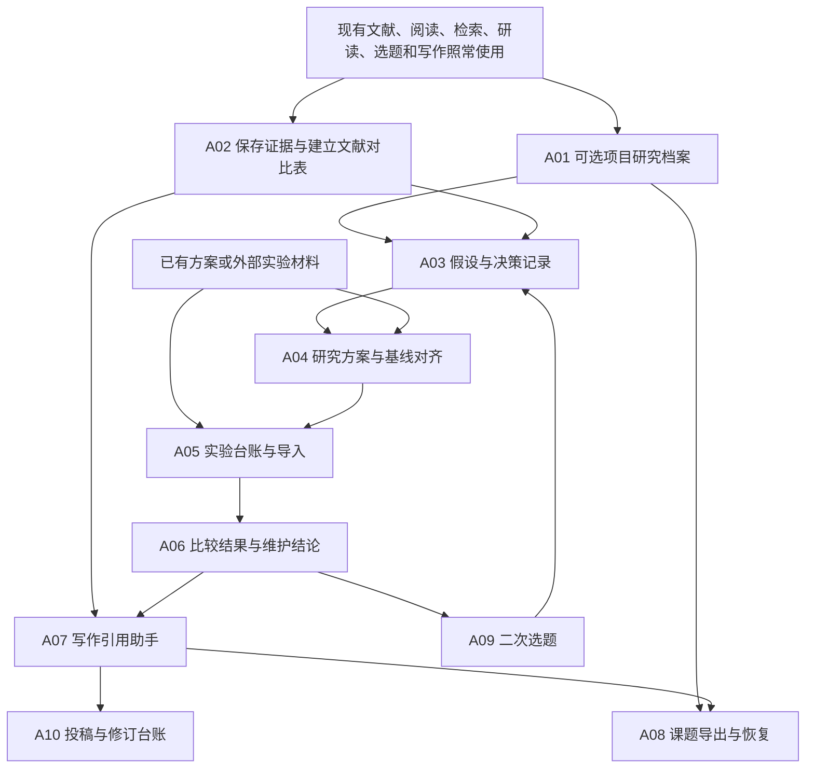

## 三、逐项新增设计

### A01 项目研究档案与概览

**新增效果：** 在已有项目上附加一页研究概览，回答当前研究什么、有哪些成果、下一步做什么。

**现有基础：** 项目身份、文献集合、会话归属、资源配置。  
**新增入口：** 项目操作菜单中的“研究概览”。用户打开后才进入新面板，旧主页和文献列表保留。  
**最小输入：** 选择现有项目；问题和目标可以先留空。

| 子环节 | 操作设计 | 新增产物 |
| --- | --- | --- |
| A01.1 建立研究档案 | 为选定项目启用档案，绑定现有项目 ID | 可选研究档案 |
| A01.2 记录研究问题 | 输入问题、范围、目标和现实约束 | 问题卡草稿 |
| A01.3 关联已有成果 | 用户选择已有论文、报告、笔记和稿件 | 成果关联，不复制或移动原件 |
| A01.4 记录下一步 | 添加行动、阻塞和阶段目标 | 行动清单 |
| A01.5 展示概览 | 汇总真实记录与最近更新 | 概览页和轻量时间线 |
| A01.6 继续工作 | 从记录跳回原有阅读、研读或写作入口 | 保留来源与项目上下文的跳转 |

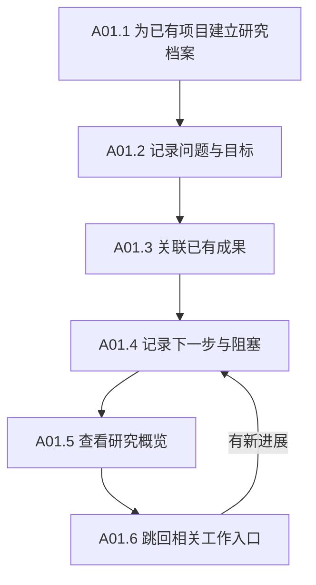

**验收：** 原项目内容和 ID 不变；关闭新面板不影响旧工作区；不启用研究档案也能使用全部旧功能。概览不编造进度百分比。

**异常与边界：** 旧成果失效时显示失效链接；不自动从聊天中推断并确认研究事实；删除档案的默认动作只处理新增档案与关联，不删除项目文献。

### A02 证据卡与文献对比表

**新增效果：** 把阅读摘录和检索发现保存为可反查的证据，并在一个表里比较多篇论文。

**现有基础：** 原文选择、解析版本、引用页码与元素、检索证据。  
**新增入口：** 选区或证据菜单中添加“保存为证据”；项目研究面板添加“文献对比”。原有翻译、加入对话等动作保留。  
**最小输入：** 选中的来源及内容，或用户手工添加的一条带来源笔记。

| 子环节 | 操作设计 | 新增产物 |
| --- | --- | --- |
| A02.1 保存来源 | 读取已有资源、版本、页码或元素位置 | 固定来源的证据候选 |
| A02.2 补充用途 | 记录事实、作者结论、解释或个人观察 | 类型和适用条件 |
| A02.3 建立对比表 | 选择文献与比较列，允许自定义列 | 文献矩阵 |
| A02.4 填写单元格 | 手填或 AI 建议，值附带原文来源 | 可核对单元格 |
| A02.5 标记差异 | 标记条件不同、无报告、缺资料或矛盾 | 比较限制与补充任务 |
| A02.6 交给下一步 | 导出表格或关联假设、笔记和稿件 | 明确的成果引用 |

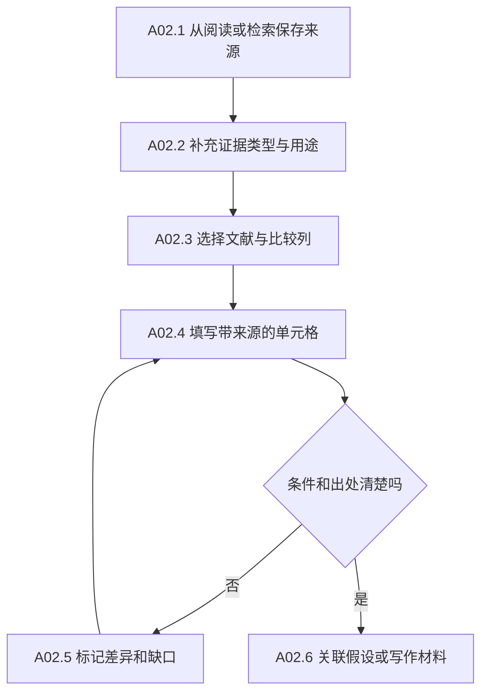

**验收：** 单击关键单元格能回到原文；零值、未报告、未核对和不适用分别表示。AI 填写保留候选标记，人工可以直接修改。

**异常与边界：** 无固定版本的外部资料保存来源快照或标记定位不足；不为了该模块重新建设解析与检索。矩阵提示不可比条件，但不阻止用户保存未完成的比较表。

### A03 假设与研究决策记录

**新增效果：** 为“为什么尝试这个方向”建立长期记录，同时保留反例、失败思路与暂缓理由。

**现有基础：** 选题报告、研读笔记、证据卡和自由对话。  
**新增入口：** 项目研究面板的“想法与假设”，以及保存成果时的“关联研究假设”。  
**最小输入：** 一段研究想法；关联证据可稍后补充。

| 子环节 | 操作设计 | 新增产物 |
| --- | --- | --- |
| A03.1 登记想法 | 手动填写，或从现有报告复制选定部分 | 假设草稿 |
| A03.2 补充可验证内容 | 描述预测、前提、作用范围和反例 | 可验证假设卡 |
| A03.3 关联依据 | 连接证据、笔记和已知相反结果 | 支持、反对与未知项 |
| A03.4 作出选择 | 记录继续、搁置、修改或停止及其理由 | 研究决策 |
| A03.5 进入验证 | 可选生成研究方案草稿 | 与 A04 的关联 |
| A03.6 回收研究结果 | 关联实验与结论，记录判断变化 | 假设历史 |

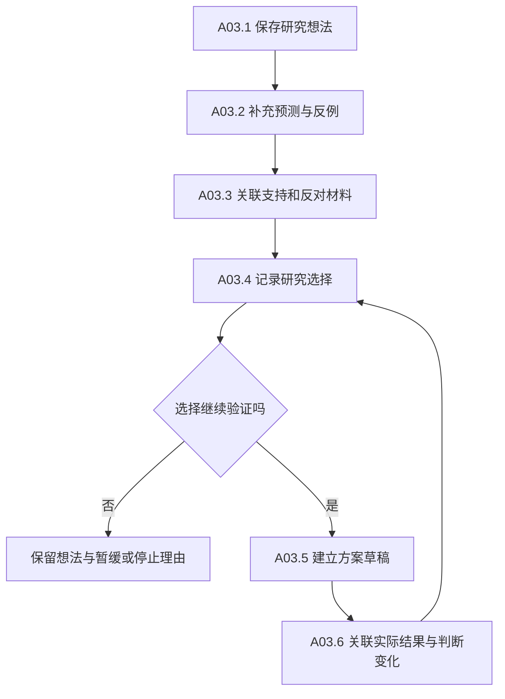

**验收：** 一条想法可以查看来源、当时选择和后续结果；未支持的假设能够正常保留；旧对话和报告不被改写。

**异常与边界：** 没有足够证据时允许保存为草稿；AI 可以建议反例和下一步，但不自动把假设改成“已证实”。

### A04 研究方案与基线对齐表

**新增效果：** 接住现有研读生成的计划，记录实际要用的数据、指标、对照以及与参考论文的差异。

**现有基础：** 研读计划中的假设、变量、对照、指标与失败判据。  
**新增入口：** 研读成果中的“保存为研究方案”；也支持从研究面板直接新建。  
**最小输入：** 现有计划或手写方案，不强制先完成 A02、A03。

| 子环节 | 操作设计 | 新增产物 |
| --- | --- | --- |
| A04.1 导入计划 | 复制选定计划内容并保留来源 | 独立方案草稿 |
| A04.2 填写验证设置 | 数据版本、划分、指标定义、对照和预算 | 实际验证方案 |
| A04.3 比较基线条件 | 对比论文说明、仓库配置和实际条件 | 基线对齐表 |
| A04.4 保存方案版本 | 保存一个用于本轮执行的方案快照 | 可引用的方案版本 |
| A04.5 创建实验记录 | 将选定方案带到实验台账 | 关联的逻辑实验 |
| A04.6 记录后续变更 | 修改条件时创建新版本并说明理由 | 方案修订与差异 |

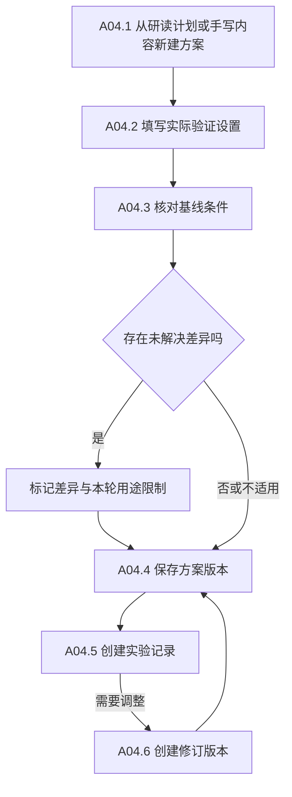

**验收：** 研读仍按原流程完成；研究方案是新增对象；修改方案不改变以前运行引用的版本。没有基线的研究可以选择不适用。

**异常与边界：** 数据或指标未填齐时可保存草稿，缺口直接显示；不把新增表单作为继续阅读、对话或写作的门槛。

### A05 实验台账与已有结果导入

**新增效果：** 将用户在原有环境中运行的实验、配置、日志、指标和失败记录纳入项目。

**现有基础：** 外部脚本和结果文件，平台已有资源登记与版本机制。  
**新增入口：** 研究面板中的“实验”；支持直接导入，不要求先创建完整研究方案。  
**最小输入：** 实验名称、结果文件或手动记录；缺少的代码与环境信息显示为未记录。

| 子环节 | 操作设计 | 新增产物 |
| --- | --- | --- |
| A05.1 建立实验 | 记录实验目的、可选方案与分组 | 逻辑实验 |
| A05.2 选择导入内容 | 手动、CSV、JSON 或用户选定运行目录 | 导入批次草稿 |
| A05.3 预览字段 | 映射指标列、单位、配置和产物，检测重复 | 字段映射与导入预览 |
| A05.4 登记运行 | 保存实际代码、数据、环境及已知输入 | 独立运行记录 |
| A05.5 关联结果与错误 | 登记指标、日志、图像、模型及失败原因 | 结果和失败产物 |
| A05.6 管理尝试关系 | 记录重试、续跑、恢复点和条件变化 | 前后运行关系 |

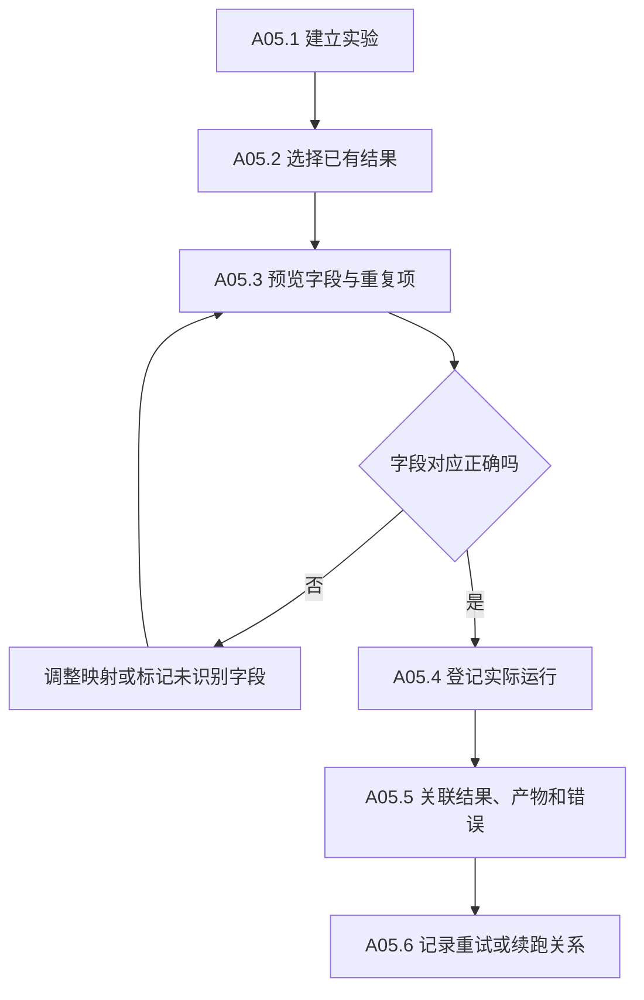

**验收：** 导入不执行脚本；失败结果也可以保存；重复导入有预览与可解释处置；同一次实验的不同运行不会互相覆盖。

**异常与边界：** 外部文件采用引用还是受管副本由导入时选择；只读取用户选定范围。阈值、优化器状态、数据划分或指标列映射未知时不猜测。远程运行、自动 SSH 和训练调度不包含在该项中。

### A06 结果比较、结论卡与成果关联

**新增效果：** 从已登记运行中组织可比较的结果，记录它支持什么判断，并将已有图表与结论关联。

**现有基础：** 导入结果、文献证据、已有绘图与成果查看能力。  
**新增入口：** 实验列表中的“比较选中运行”，研究面板中的“结论与成果”。  
**最小输入：** 两组或多组可说明口径的结果；也允许登记单个运行的观察。

| 子环节 | 操作设计 | 新增产物 |
| --- | --- | --- |
| A06.1 选择比较对象 | 选择运行和指标，保留纳入、排除理由 | 比较集合 |
| A06.2 核对比较口径 | 检查数据划分、指标定义、阈值和预算差异 | 可比性说明 |
| A06.3 保存分析快照 | 记录比较表、必要计算及其输入版本 | 分析快照 |
| A06.4 记录结论 | 写出准确表述、支持证据、反证和局限 | 结论卡 |
| A06.5 关联已有图表 | 导入或选择图表，连接源数据和生成材料 | 成果来源记录 |
| A06.6 检查更新影响 | 输入或评价口径变化后列出受影响的新增记录 | 待复核与重新计算提示 |

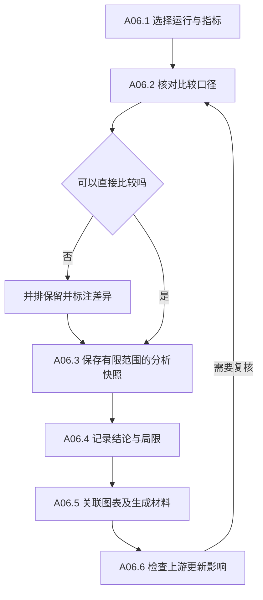

**验收：** 结论能回到结果和配置；无法直接比较时不自动排行；图表可以回查所用分析版本。负结果、探索性观察和正式结论有明确区分。

**异常与边界：** 首期支持比较表、基本差异说明和外部分析结果关联，不另造通用统计或绘图平台。影响提示首先覆盖新增对象及显式登记的稿件位置，不承诺自动理解全部旧笔记的引用关系。

### A07 写作引用助手与稿件登记

**新增效果：** 在现有写作区域方便地选文献、整理书目，并将稿件与研究结论、图表联系起来。

**现有基础：** Markdown、LaTeX、BibTeX 编译、文献元数据和已有成果。  
**新增入口：** 现有写作工作区添加可选“引用与研究材料”侧栏。编辑器仍然可以直接打开和编辑普通文件。  
**最小输入：** 当前文件或用户选定稿件；使用文献引用不要求先建设实验台账。

| 子环节 | 操作设计 | 新增产物 |
| --- | --- | --- |
| A07.1 登记稿件 | 关联已有文件，填写标题和可选课题 | 稿件记录，不移动原文件 |
| A07.2 选择文献 | 从已有文献库选择条目，核对关键元数据 | 稳定引用键和书目条目 |
| A07.3 插入或导出引用 | 按格式插入引用标记，预览 `.bib` 输出 | 正文引用或书目文件 |
| A07.4 关联研究材料 | 将选定段落、图表与证据或结论相连 | 稿件使用位置记录 |
| A07.5 运行可选检查 | 查看缺失条目、重复键、过期材料与定位失配 | 检查清单 |
| A07.6 保存稿件快照 | 保存正文、书目与所用图表清单 | 稿件版本快照 |

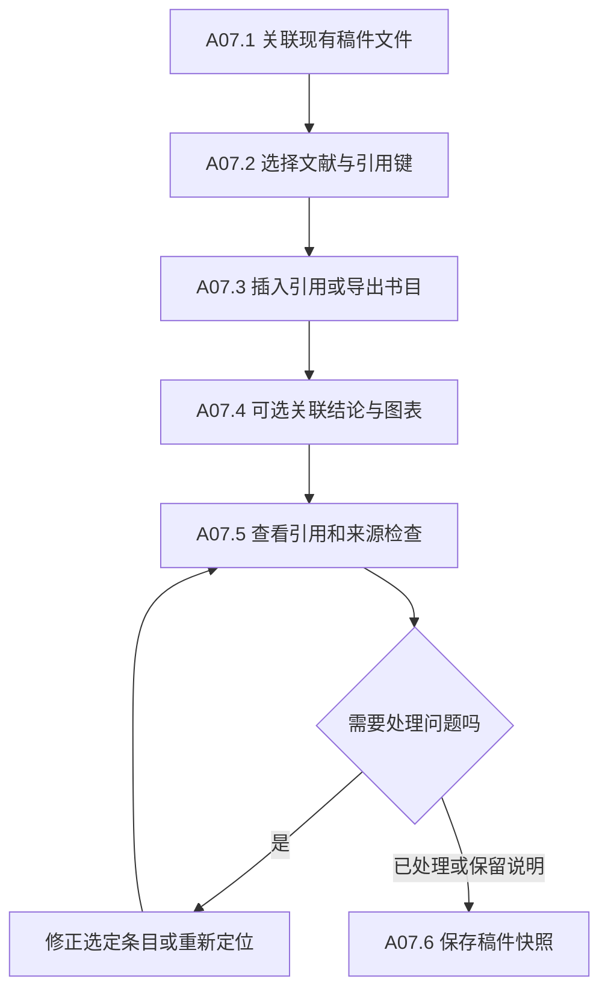

**验收：** 没有稿件记录的普通文件仍可编辑；新引用键不会静默覆盖已有键；生成书目先展示目标与差异；历史稿件快照不会被后续元数据更新改写。

**异常与边界：** 外部编辑造成段落锚点失配时显示待定位，不自动关联到相似但错误的段落。Word 动态引用、编辑器替换和全自动论文写作不纳入该项。

### A08 课题导出、备份与恢复工具

**新增效果：** 将选定课题及其研究记录打包，在独立位置恢复，并明确哪些外部材料没有包含。

**现有基础：** SQLite 清单、受管文件、版本、回收站和已有迁移备份。  
**新增入口：** 项目菜单“导出课题包”，资料工具中的“导入／恢复课题包”。  
**最小输入：** 选择项目与导出范围；常规内容包默认不包含认证凭据。

| 子环节 | 操作设计 | 新增产物 |
| --- | --- | --- |
| A08.1 选择范围 | 勾选新增记录、文献、稿件和需要的文件 | 包含与排除清单 |
| A08.2 检查一致性 | 固定记录版本，检查正在写入和缺失文件 | 快照边界与缺口说明 |
| A08.3 生成并校验包 | 保存内容、关系、版本和校验信息 | 可移植课题包 |
| A08.4 预览恢复 | 选择独立目标，检查版本、身份和路径冲突 | 恢复预览 |
| A08.5 恢复与重接 | 恢复受管内容，重新定位外部资料 | 已恢复课题及外部缺口 |
| A08.6 抽查研究链路 | 打开原文、运行、图表和稿件的代表性关系 | 恢复报告 |

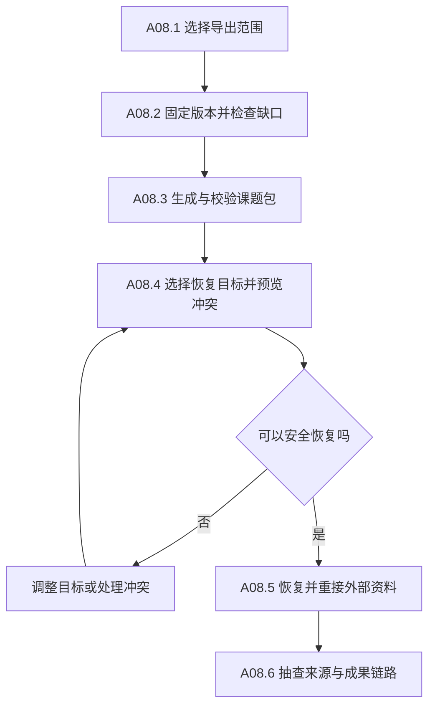

**验收：** 备份恢复不覆盖正在使用的资料；恢复后关键关联有效；外部数据、索引和凭据是否包含明确列出。原有回收站与迁移工具继续使用。

**分批范围：** 第一批先保证新增研究记录可以导出和恢复；第二批纳入运行和产物清单；第三批完成稿件与整个课题的打包验收。未包含原文或外部大文件的包标为部分导出，不能称作完整备份。

### A09 基于已有成果的二次选题

**新增效果：** 利用已经阅读的论文、形成的结论、失败实验和资源变化提出后续研究问题。

**现有基础：** 初次选题流程、学术检索、已有报告和研究记录。  
**新增入口：** 选题页添加“基于已有课题继续选题”；原初次选题入口及默认规则保留。  
**最小输入：** 选择项目成果，也允许只选现有笔记和报告，不要求完成全部新增模块。

| 子环节 | 操作设计 | 新增产物 |
| --- | --- | --- |
| A09.1 选择研究上下文 | 指定已有论文、假设、结果和技术栈 | 本次分析输入快照 |
| A09.2 整理未解问题 | 分出已完成、失败、证据不足和新出现的问题 | 未解问题清单 |
| A09.3 补充检索 | 复用已有来源能力，记录时间与覆盖 | 新证据与检索记录 |
| A09.4 形成候选方向 | 描述与旧工作的关系、验证动作和资源条件 | 后续方向候选 |
| A09.5 选择下一步 | 继续、收缩、转向或停止，保留理由 | 研究决定 |
| A09.6 回写新草稿 | 创建假设或研究方案，保留旧成果引用 | 下一轮研究入口 |

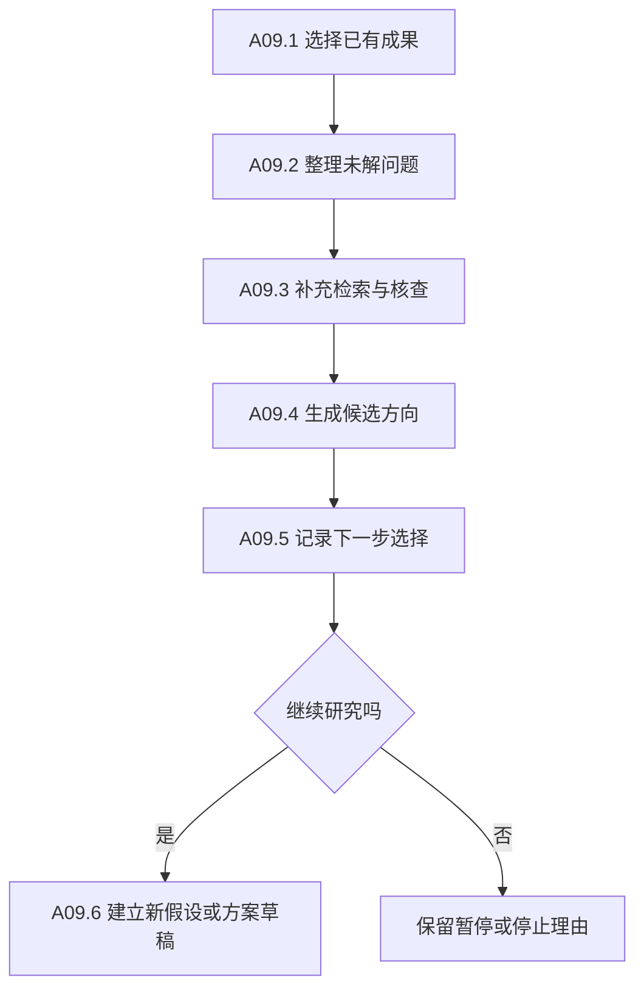

**验收：** 新方向明确引用过去做过的工作；既有失败不会被忽略；新草稿不覆盖原选题报告；材料不足时返回可见缺口。

**异常与边界：** 不承诺自动证明创新性。需要改变筛选策略时，在新模式中显式设置，不顺带改变现有初次选题规则。

### A10 投稿与审稿修订台账

**新增效果：** 记录一个稿件的投稿轮次，把审稿意见与修改位置、证据和补充实验对应起来。

**现有基础：** 稿件、图表、分析和实验记录，也支持关联外部稿件。  
**新增入口：** 稿件记录中的“投稿与修订”。  
**最小输入：** 稿件和投稿目标；可以只记录，不要求使用内置编辑器。

| 子环节 | 操作设计 | 新增产物 |
| --- | --- | --- |
| A10.1 建立投稿轮次 | 保存目标、日期、材料要求和来源 | 投稿轮次草稿 |
| A10.2 保存提交快照 | 选定稿件、图表、补充材料及回执 | 实际提交文件清单 |
| A10.3 拆解意见 | 导入或粘贴意见，分为解释、修改、补实验等 | 意见条目与任务 |
| A10.4 关联处理成果 | 连接修改位置、新结论、补实验和回复草稿 | 意见处置记录 |
| A10.5 检查回复一致性 | 检查回复所声称的修改是否有对应位置 | 待处理与已处理列表 |
| A10.6 归档或进入下一轮 | 保存本轮结果，新建修订或改投轮次 | 可追溯投稿历史 |

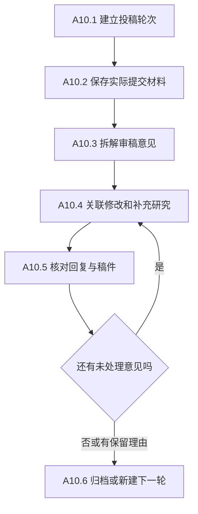

**验收：** 每条意见都能查看处理状态、证据和修改位置；改投不会覆盖上一轮；准备提交与实际提交分别表示。

**异常与边界：** 只整理和导出材料，不自动登录投稿网站、发送邮件或回复审稿人。论文未录用也可以正常保存和归档。

### O01 可选：持久化视频资料库

**新增效果：** 用户选择保存的视频及分析可以在刷新后重新打开。

**现有基础：** 视频播放、截帧、时间轴与独立对话。  
**新增入口：** 视频页增加“保存为资料”；临时打开视频的方式继续保留。

| 子环节 | 操作设计 | 新增产物 |
| --- | --- | --- |
| O01.1 选择保存方式 | 本地引用、受管副本或远程链接 | 持久化媒体身份 |
| O01.2 保存定位信息 | 记录时间戳、片段、截图和来源版本 | 可定位视频证据 |
| O01.3 关联已有分析 | 保存时间轴、导图和会话引用 | 媒体分析清单 |
| O01.4 恢复与重定位 | 刷新后重新打开，路径失效时核对文件 | 恢复入口和失效状态 |

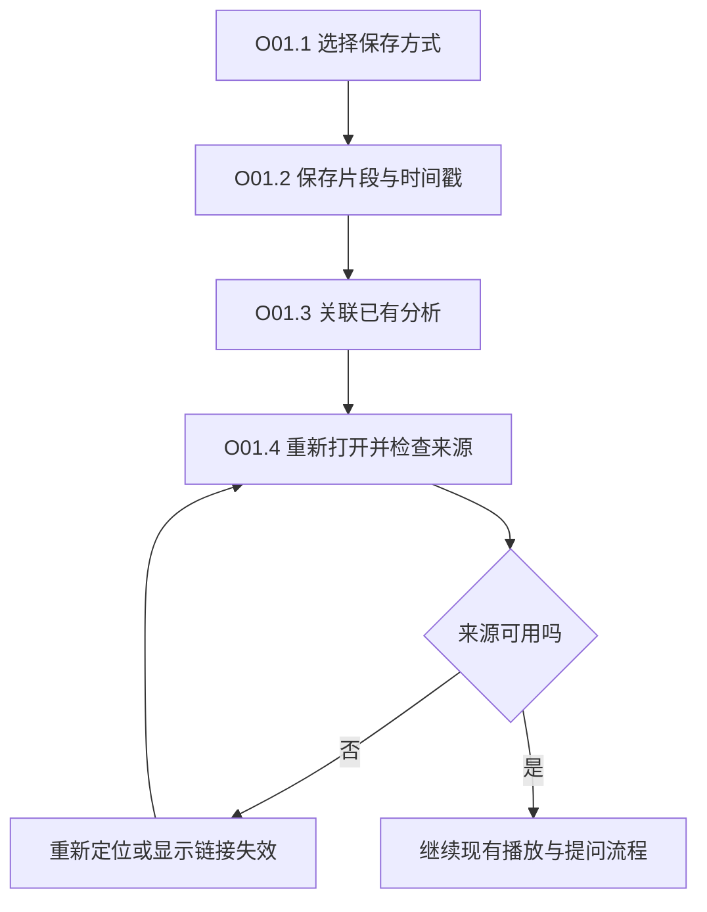

**验收：** 临时视频仍可直接使用；保存后的资料可恢复；远程链接失效不伪装为本地内容；不顺带增加新的视频编辑与生成系统。

## 四、新增模块怎样接入现有项目

### 4.1 入口接入

建议首先增加一个可选“项目研究”面板，内部承载概览、证据、假设、方案、实验和结论。现有阅读、检索、研读、选题与写作只增加相应的交接动作。

| 原位置 | 新增动作或区域 | 保留的原行为 |
| --- | --- | --- |
| 项目操作菜单 | 研究概览、导出课题包 | 原项目管理和论文分组 |
| 阅读选区 | 保存为证据 | 翻译、加入对话、原有批注 |
| 检索证据卡 | 保存到课题证据 | 原文展示、翻译、加入对话 |
| 研读成果 | 保存为研究方案 | 研读步骤、考查和完成状态 |
| 选题页面 | 基于已有课题继续选题 | 初次选题和方向分析 |
| 写作工作区 | 可选引用与研究材料侧栏 | 原编辑、保存、AI 差异和编译 |
| 资料工具 | 导入／恢复课题包 | 原资源、任务、核对和回收站 |
| 视频页面 | 保存为资料 | 临时打开、播放、截帧和对话 |

新入口不抢占用户已经打开的面板，不迁移旧布局；是否固定显示，由用户实际使用和已有布局机制决定。

### 4.2 数据接入

1. 新研究档案关联现有项目 ID，信息不完整时保持草稿，不改变原项目的基本可用性。
2. 证据优先引用现有资源 ID、版本、块或元素与页码；可以使用现有 Citation 概念，避免再造一套原文定位。
3. 新方案、运行、结论与稿件登记使用现有受管存储和版本能力；只增加需要的业务记录及关系。
4. 新关系明确区分“使用来源”和“拥有文件”。解除关联不能被解释为删除原文或外部实验目录。
5. 旧资料仅在用户主动选取时建立新关系，不进行全量补标、推断或搬迁。
6. 新增对象使用既有任务状态、取消与修订冲突能力；其“研究判断”另行记录，不重定义已有后台任务成功的含义。
7. 新模块的检索范围写在新面板中；现有知识检索的默认范围和行为保留。

### 4.3 一次交接的统一流程

交接保存来源版本、目标项目和创建对象。重复提交要能识别；失败时保留草稿，并让原阅读或写作页面继续可用。

### 4.4 兼容验收的最低要求

| 验收项 | 通过条件 |
| --- | --- |
| 不使用新功能 | 原文献、阅读、对话、研读、检索、写作与视频路径照常可用 |
| 旧项目没有研究字段 | 能正常打开；仅在新增面板显示可填写空状态 |
| 新面板加载失败 | 错误局限在新面板，用户可返回原功能 |
| 旧 ID、URL 和资源链接 | 继续可访问，引用原版本的行为保持 |
| 原布局与草稿 | 加新入口不清空布局，不覆盖原编辑草稿 |
| 多项目切换 | 新对象归属正确，不从旧页面拿错项目身份 |
| 新对象删除 | 只按明确归属处理，保护共享原文与外部文件 |
| 模型不可用 | 手动新增、编辑和查看研究记录仍可进行 |

若某个新增能力确实需要较大范围改动，先缩小该能力的实现范围，或把大改动单列为后续提案，不能悄悄并入当前加法工作包。

## 五、推荐开发顺序与工作包

### 5.1 第一批：把已有阅读与研究成果组织起来

**范围：A01、A02、A03，加上这些新记录的基础导出与恢复。**

| 工作包 | 具体内容 | 验收成果 |
| --- | --- | --- |
| B1.1 可选研究面板 | 新入口、现有项目关联、草稿与错误状态 | 原界面可独立使用，新面板可正常开关 |
| B1.2 项目研究档案 | 问题、目标、行动、成果关联和概览 | 能回答当前研究什么与下一步做什么 |
| B1.3 证据卡 | 从阅读和检索保存固定来源的证据 | 点击证据可回原文版本 |
| B1.4 文献对比表 | 选文献、配列、填值、附来源、标差异 | 5—10 篇代表性论文可进行有出处的比较 |
| B1.5 假设与决定 | 草稿、支持与反证、选择理由和历史 | 一个想法能够解释来源与研究取舍 |
| B1.6 保护新增资料 | 新对象的保存、版本、回收、基础导出与恢复 | 新研究记录可恢复，旧资料不受影响 |

**第一批结束后的可用路径：** 选已有项目 → 阅读论文 → 保存证据 → 对比文献 → 记录研究假设和下一步。已有选题、研读、实验脚本和写作方式继续使用。

### 5.2 第二批：接入真实实验与结果

**范围：A04、A05、A06，扩展导出包中的实验记录与文件清单。**

| 工作包 | 具体内容 | 验收成果 |
| --- | --- | --- |
| B2.1 研读计划交接 | 复制计划为独立方案，补充实际设置 | 原研读完成状态不变 |
| B2.2 方案与基线 | 方案版本、对照、指标、差异和变更 | 原文设置与实际设置可区分 |
| B2.3 实验导入 | 手动、CSV/JSON、选定目录、字段映射 | 用户现有结果能被正确登记 |
| B2.4 运行与失败 | 结果、配置、产物、错误、重试和续跑 | 多次尝试不互相覆盖 |
| B2.5 比较与结论 | 可比性说明、分析快照、结论卡与图表关联 | 一条结论可回查实际结果 |
| B2.6 变化与恢复 | 对新增对象提示上游变化，支持记录与清单恢复 | 修改评价口径可找到受影响分析 |

**第二批结束后的可用路径：** 现有实验脚本运行 → 导入结果 → 比较口径 → 保存结论 → 关联图表。平台不接管用户原有训练环境。

### 5.3 第三批：让研究成果进入现有写作流程

**范围：A07、A08 的完整课题导出与恢复验收。**

| 工作包 | 具体内容 | 验收成果 |
| --- | --- | --- |
| B3.1 引用侧栏 | 文献选择、引用键与书目输出 | 直接帮助当前 Markdown 或 LaTeX 写作 |
| B3.2 稿件登记 | 关联原文件、章节材料与成果 | 文件仍可按原方式编辑 |
| B3.3 来源使用位置 | 关联选定段落与结论、图表 | 稿件关键内容能够反查来源 |
| B3.4 检查与快照 | 引用错误、失配锚点、过期材料和版本快照 | 当前稿件与历史版本分别可查 |
| B3.5 完整课题包 | 快照一致性、文件范围、校验与恢复预览 | 独立恢复后主要研究链路可用 |

**第三批结束后的可用路径：** 文献／实验 → 结论／图表 → 现有稿件 → 引用与来源检查 → 课题包。无需另建一套论文编辑器。

### 5.4 第四批：向后续研究与投稿延伸

**范围：A09、A10；O01 按实际需求单独排期。**

| 工作包 | 具体内容 | 验收成果 |
| --- | --- | --- |
| B4.1 二次选题上下文 | 选择已有文献、结果、失败和技术栈 | 可解释本轮选题的输入范围 |
| B4.2 后续方向与交接 | 补检索、形成候选、回写新假设或方案 | 旧成果保持，新增研究草稿有来源 |
| B4.3 投稿轮次 | 稿件关联、材料清单、快照和回执 | 真实提交记录可回查 |
| B4.4 修订台账 | 意见拆解、补实验、修改位置和回复对应 | 审稿意见逐条有处置记录 |
| B4.5 可选媒体持久化 | 保存视频身份、时间戳、分析和恢复入口 | 刷新后可继续已保存的视频研究 |

### 5.5 批次依赖图

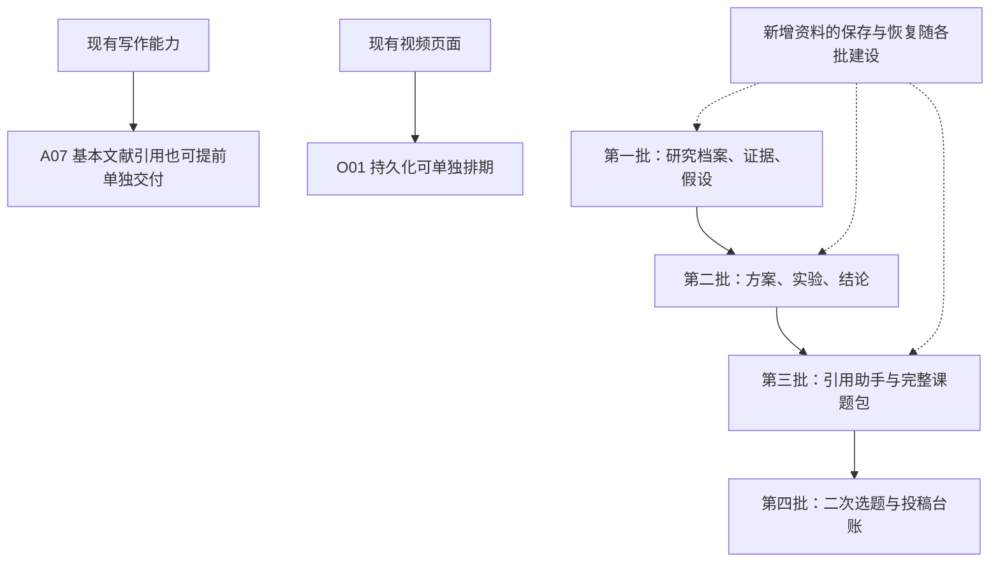

这里的顺序是依赖与产品价值建议。A07 的基本引用不依赖实验台账，O01 不依赖研究主线；可以按用户实际痛点调整。未确定人力和首批范围之前，不给固定日历工期。

## 六、用现有 CFM 材料验收加法是否有效

不改变原有实验脚本和执行方式，只把实际材料接入新增模块。

| 步骤 | 复用的现有材料 | 使用的新功能 | 应解决的问题 |
| --- | --- | --- | --- |
| 1 | 已有论文和审计报告 | A01 研究档案 | 随时能看懂当前问题与下一步 |
| 2 | 原文表格和分析摘录 | A02 证据卡与对比表 | 说明每个比较值来自哪里 |
| 3 | 探索性失败模式 | A03 假设记录 | 区分观察、推测与得到支持的判断 |
| 4 | 论文、仓库和实际配置 | A04 对齐表 | 保留批量、轮次、优化器状态等差异 |
| 5 | 已有 CSV、配置和日志 | A05 实验导入 | 正确识别指标列与失败运行 |
| 6 | 原分析与修正分析 | A06 比较和结论 | 不把修正分析误当成训练根因已查明 |
| 7 | 现有图表和稿件 | A07 引用助手 | 将结果段落连接到结论和真实结果 |
| 8 | 上述新增记录与选定文件 | A08 课题包 | 换目录后还能恢复主要来源关系 |

**关键更正验收：** 改变一项评价列映射时，平台找到依赖它的比较、结论与显式关联稿件位置；原训练产物不被覆盖；尚未登记的旧段落不被假报为已完整审查。

**加法验收：** 在整个例子中，原有阅读、聊天、研读、检索和编辑器随时可用。新模块只提供组织、衔接和追溯能力，不要求用户重新学习一套完整替代流程。

## 七、与上一份整体规划的对应关系

| 上一份规划内容 | 本增量版处理 |
| --- | --- |
| 环境诊断、文献发现、解析、阅读与研读 | 视为现有基础，按新增功能需要局部接入 |
| 课题中心、证据、假设 | 收敛为 A01—A03 的可选研究面板 |
| 方案、基线、运行、分析与结论 | 收敛为 A04—A06，优先接用户已有结果 |
| 图表系统 | 复用现有生成与查看，增加来源关联 |
| 稿件与引用 | 收敛为 A07，增强已有编辑器 |
| 备份与归档 | 收敛为 A08 的课题工具，分批实现 |
| 二次选题、投稿与修订 | 作为 A09—A10 后续新增功能 |
| 视频资料库 | 作为 O01 可选项 |
| 全局导航、状态与架构全面调整 | 移出当前开发范围 |
| 全平台质量与性能治理 | 只保留新增功能必要验收，专项建设另行规划 |
| 团队权限、多进程与远程执行 | 移出当前开发范围 |

### 7.1 文档使用规则

- 下一步若用户要求“按计划开发”，应以本文件的加法边界为依据，再确定具体批次。
- 全流程文档用于解释业务背景，不把其中所有环节自动视为待开发功能。
- 已有功能的问题修复、重构和新增能力分别列明，不合并成未经说明的改造。
- 所有批次当前均为“未开始”；本次仅完成范围修正与文档交付。

### 7.2 参考依据

- [原整体规划](PiPaper_科研工作平台全流程规划_2026-10-06.md)：保留作为完整业务背景。
- [现有功能说明](README.md)：确认可以直接复用的能力。
- [当前架构与开发约定](docs/architecture.md)：确认现有平台能力与接入边界。
- [工作区导航](src/workspaceNavigation.js)：确认新增入口应接入的位置。
- [项目数据](server/store.js)：复用已有项目身份。
- [共享契约](shared/contracts/index.d.ts)：复用资源、任务与引用概念。

本文件只做新增功能设计；本轮未修改任何项目实现或运行数据。
