# PiPaper 科研工作平台全流程规划

> 文档日期：2026-10-06  
> 文档性质：产品与业务流程设计稿，供逐项讨论、排期和后续实施使用。  
> 本次交付：仅新增本 Markdown 文档；不修改现有代码、配置、数据、依赖、数据库或项目目录结构，不启动实施。  
> 现状依据：上一轮项目审查，以及本轮对当前架构说明、共享契约和工作区变更状态的只读复核。文中的“规划”“建议”均不代表已经实现。

## 阅读导航

1. [定位、边界与现状](#一定位边界与现状)
2. [科研主流程总览](#二科研主流程总览)
3. [十五个业务环节的详细设计](#三十五个业务环节的详细设计)
4. [六项贯穿全流程的支撑能力](#四六项贯穿全流程的支撑能力)
5. [页面与跨环节交接设计](#五页面与跨环节交接设计)
6. [研究对象、版本与状态设计](#六研究对象版本与状态设计)
7. [分阶段交付计划与工作拆解](#七分阶段交付计划与工作拆解)
8. [端到端验收场景](#八端到端验收场景)
9. [待定事项、风险与范围控制](#九待定事项风险与范围控制)
10. [现状依据与术语](#十现状依据与术语)

流程图使用 Mermaid，直接保存在 Markdown 中。S00—S14 为业务环节，X01—X06 为支撑环节；各图中的子步骤编号与对应表格一致。整体流程允许回退、分支和跳过不适用的阶段。

## 一、定位、边界与现状

### 1.1 产品目标

以一个真实研究课题为中心，持续管理研究问题、来源证据、研究方案、实验与分析、结论、图表、稿件和投稿记录。研究人员能够从一条论文结论追溯到支撑它的文献或实验，也能够知道修改某项输入会影响哪些成果。

成熟度以实际工作结果衡量：

- 间隔两周重新打开课题，能看懂当前进展、未解决问题和下一步行动。
- 新增一篇论文或一组结果后，能定位需要重新审视的假设、结论和稿件位置。
- 一次失败实验有明确记录，后续能够复查失败原因与当时的判断。
- 将课题移到另一台设备后，关键材料、引用关系和历史版本可以恢复。
- 导出论文或共享成果时，能够明确区分已核对事实、研究者推断、探索性结果和待验证假设。

### 1.2 首期目标用户与研究范围

默认先服务单个研究者，再扩展到小课题组。首个完整实施样例采用计算实验型课题，适合当前项目中的论文复现、模型实验和 CFM 研究材料。

同时保留以下研究模式，避免所有课题都被要求训练模型：

| 研究模式 | 必需主线 | 可选或替代环节 |
| --- | --- | --- |
| 计算实验与方法研究 | 问题、证据、实验方案、运行、分析、结论、稿件 | S08 进行基线复现；S09 记录计算运行 |
| 文献综述 | 问题、检索策略、筛选记录、证据抽取、综合、稿件 | S07 保存综述方案；S08 可跳过；S09 记录筛选与抽取批次 |
| 理论研究 | 问题、定义与假设、推导或证明、验证、稿件 | S08 可跳过；S09 记录证明版本、符号验证或反例搜索 |
| 观察与其他实证研究 | 问题、研究方案、资料收集、分析、结论、稿件 | 运行记录可表示采集批次与分析批次；领域专用流程后续扩展 |

首期不承诺覆盖所有学科的专业规范。研究类型决定模板、必填字段和阶段门槛；研究者可以说明某步骤“不适用”，并保留理由。

### 1.3 现有能力与本次规划的关系

| 能力 | 当前可确认基础 | 需要补充的部分 | 处理方式 |
| --- | --- | --- | --- |
| 文献与项目 | 文献导入、Zotero、文献集合和会话分组 | 研究问题、阶段目标、项目总览与决策记录 | 扩展项目语义 |
| 解析与阅读 | 解析版本、页码与元素证据、翻译、批注 | 质量核对结果跨环节使用、阅读成果交接 | 复用并接通 |
| 独立研读 | 粗读、精读、考查、实验计划与成果快照 | 计划转为真实研究方案，后续运行回接 | 保留研读，增加交接 |
| 检索与选题 | 多路召回、引用核对、真实来源、选题报告 | 文献矩阵、持续证据卡、二次选题、可配置策略 | 扩展研究业务 |
| 存储与任务 | 版本、回收站、依赖失效、持久化检查点 | 项目级研究关系、完整备份、研究执行记录 | 复用基础机制 |
| 写作 | Markdown 编辑、AI 差异确认、LaTeX/BibTeX 编译 | 稿件结构、文献引用管理、图表来源、投稿快照 | 扩展写作流程 |
| 视频 | 播放、截帧、时间轴分析、独立会话 | 持久化媒体身份、时间戳证据与恢复 | 第二阶段以后接入 |
| 工程验证 | 语法与边界检查、自动测试、真实评测入口 | 真实科研质量题集、完整用户路径、成本与性能指标 | 逐阶段补齐 |

### 1.4 设计约束

1. **以课题串联工作。** 文献、研读、实验和稿件可独立使用；关联课题后共享上下文与来源关系。
2. **保留已有身份和成果。** 文献 ID、解析版本、会话、研读记录、旧附件链接不能因新规划而自动失效。
3. **研究状态与软件任务状态分开。** 模型任务成功不代表假设成立，实验运行结束不代表结果可信。
4. **研究事实与建议分开。** AI 可以提议、抽取、检查与整理；关键研究判断记录研究者的确认或异议。
5. **关键输入固定版本。** 方案、数据、指标、代码和稿件发布时形成快照；后续修改产生新版本。
6. **先支持导入真实成果。** 首期实验记录支持手动登记和文件导入；远程运行与调度作为后续适配能力。
7. **允许独立工作。** 缺少模型或向量服务时，文献阅读、手动记录、编辑和查看历史仍应可用。
8. **按依赖推进建设。** 质量检查、数据恢复和来源管理随业务建设进入验收，不统一拖到最后补做。

## 二、科研主流程总览

### 2.1 总体业务流程图

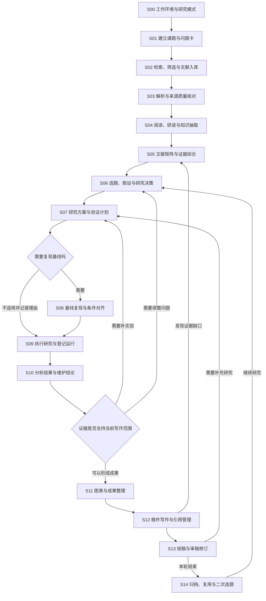

### 2.2 环节交付表

| 编号 | 核心问题 | 必须留下的成果 | 进入下一环节的条件 |
| --- | --- | --- | --- |
| S00 | 当前能开展哪些工作 | 能力清单、研究模式和默认设置 | 可用与不可用能力明确 |
| S01 | 要解决什么问题 | 课题、问题卡、阶段目标 | 研究边界与当前目标可读 |
| S02 | 已找到哪些相关资料 | 搜索记录、筛选理由、文献清单 | 来源、身份和全文可用性有记录 |
| S03 | 原文能否可靠引用 | 采用解析版本、核对项、定位证据 | 可靠区域和疑点区域可区分 |
| S04 | 从资料中理解了什么 | 阅读卡、摘录、方法与局限记录 | 原文、解释和个人想法可区分 |
| S05 | 文献之间说明了什么 | 对比矩阵、证据卡、冲突与缺口 | 比较条件和出处明确 |
| S06 | 研究哪个可验证问题 | 假设卡、备选方向、决策记录 | 核心假设、价值与可行性已讨论 |
| S07 | 怎样判断假设是否成立 | 固定版本的研究方案 | 输入、指标、对照和停止条件明确 |
| S08 | 基线是否足够可比较 | 复现记录、差距和对齐状态 | 可比较或偏差影响已说明 |
| S09 | 实际执行了什么 | 运行记录、产物与失败记录 | 每次尝试的输入输出可追溯 |
| S10 | 结果支持哪些判断 | 分析快照、结论卡、限制 | 比较口径、证据与判断对应 |
| S11 | 如何呈现结果 | 图表、数据表、图注和生成记录 | 展示数据与分析快照一致 |
| S12 | 怎样写成可核对稿件 | 稿件、引用库、证据关联 | 核心论断、图表和引用检查完成 |
| S13 | 投稿与修订处于什么状态 | 投稿快照、审稿意见、修改记录 | 投稿包一致，意见逐条有处置 |
| S14 | 如何保存和开展下一轮 | 归档包、复盘、后续问题 | 可恢复，可区分历史与新研究 |

### 2.3 阶段门槛的使用原则

- 日常阅读和探索允许材料不完整；界面显示缺口，允许继续整理。
- 形成正式比较、将结论用于稿件、冻结投稿版本时，检查相应的关键条件。
- 不适用项需要理由；未填写、无法核实和不适用是不同状态。
- 负结果、未支持假设和停止研究都属于有效研究成果。
- 门槛只确认材料与流程是否满足当前用途，不承诺自动证明科学结论正确。

## 三、十五个业务环节的详细设计

### S00 工作环境、能力诊断与研究模式

**目标：** 用户知道当前可以做什么，能够在最小配置下开始工作，并按需要启用扩展能力。

**输入：** 用户已有的文献与工具、设备环境、可选服务配置、预期研究类型。

| 子环节 | 用户与系统行为 | 输出与检查 |
| --- | --- | --- |
| S00.1 选择研究模式 | 选择计算实验、综述、理论或其他；允许后续调整 | 课题默认模板与适用阶段 |
| S00.2 选择资料位置 | 选择应用资料目录、外部文献目录和可选写作目录 | 受管文件与外部引用边界 |
| S00.3 检查核心能力 | 检查本地读写、文献阅读、历史数据兼容性 | 核心能力状态和具体错误 |
| S00.4 检查可选服务 | 按用户启用的功能检查模型、解析、向量、TeX 等 | 可用、未配置、不可达、权限不足等状态 |
| S00.5 确认研究偏好 | 设定语言、引用格式、资源预算和默认检索范围 | 可修改的默认设置 |
| S00.6 完成引导任务 | 导入一份示例或用户选择的资料，保存一条摘录 | 明确完成第一个可用动作 |

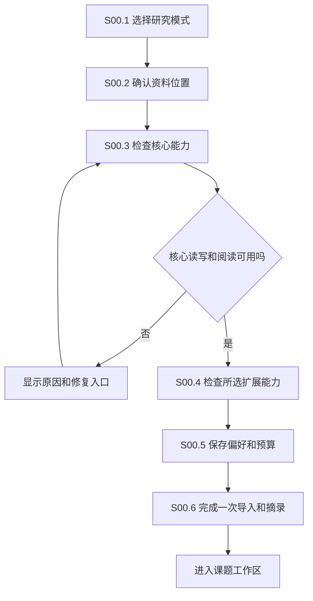

**完成条件：** 至少可保存资料、阅读资料和查看历史；扩展能力的限制明确。诊断应支持主动重试，不能把缺少向量服务变成整个平台无法使用。

**异常处理：** 不自动改动外部目录权限；失效路径显示重新定位入口；配置凭据与课题内容分开管理。付费连通性测试须显示会发生的调用，常规引导优先使用本地材料。

### S01 建立课题、研究问题与阶段目标

**目标：** 将现有“文献集合”扩展为能够承载持续研究的课题。

**输入：** 用户提出的问题、已有文献、已有选题报告或一个正在进行的研究目录。

| 子环节 | 用户与系统行为 | 输出与检查 |
| --- | --- | --- |
| S01.1 创建或接入课题 | 新建课题，或为旧项目补充研究信息 | 稳定课题身份，旧内容关联保留 |
| S01.2 建立问题卡 | 描述研究对象、问题、适用范围与预期贡献 | 可随版本演化的问题定义 |
| S01.3 记录现实约束 | 时间、硬件、数据访问、经验和预算 | 未知项保持未知，附补充任务 |
| S01.4 制定阶段目标 | 定义当前阶段、阶段产物和检查点 | 以可交付成果表述的里程碑 |
| S01.5 关联已有成果 | 选择文献、研读、报告、运行目录和稿件 | 带归属与来源的关联关系 |
| S01.6 维护行动与决策 | 记录下一步、阻塞项、决定及理由 | 项目时间线和行动清单 |
| S01.7 恢复研究上下文 | 汇总自上次访问后的变化与待处理项 | 可追溯到真实记录的项目简报 |

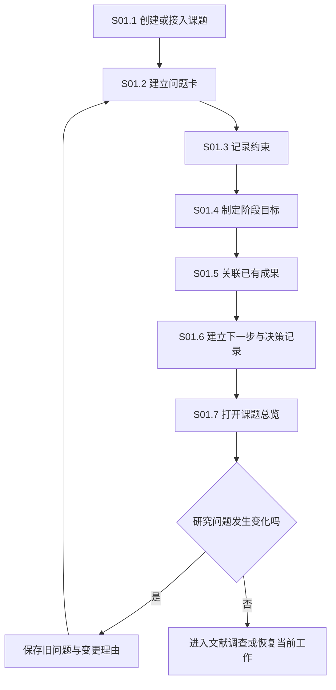

**完成条件：** 项目首页可以展示“当前问题、阶段目标、最新证据、最近结果、主要阻塞、下一步”。课题允许有多个假设和多个稿件。

**异常处理：** 不把旧会话中的所有描述自动当作研究事实。导入旧项目时，系统提出关联建议，由用户确认归属；更改研究问题保留历史，不重写过去的实验目的。

### S02 文献发现、筛选、身份核对与入库

**目标：** 保存可复查的文献调查过程，明确找到了什么、排除了什么、还有哪些资料没拿到。

**输入：** 问题卡、关键词、种子论文、已有 Zotero 集合或 DOI/链接。

| 子环节 | 用户与系统行为 | 输出与检查 |
| --- | --- | --- |
| S02.1 制定检索策略 | 将研究问题拆成概念、同义词、来源和时间范围 | 检索策略版本 |
| S02.2 执行发现检索 | 记录各来源、检索式、日期、分页和错误 | 可回放的检索批次与来源覆盖 |
| S02.3 核对文献身份 | 对齐标题、作者、DOI、年份、正式发表与预印本关系 | 文献实体与文件版本关系 |
| S02.4 初筛与归类 | 纳入、排除、待读、待定，并记录理由 | 筛选记录；综述模式保留完整清单 |
| S02.5 获取原文 | 接入已有附件、合法公开全文或用户提供文件 | 原文文件与获取来源 |
| S02.6 去重与入库 | 分别处理重复文件、同一论文不同版本和同名论文 | 去重建议、版本关系、项目关联 |
| S02.7 更新调查 | 对已有检索策略重新检查，展示新增和改变的资料 | 用户确认后的更新批次 |

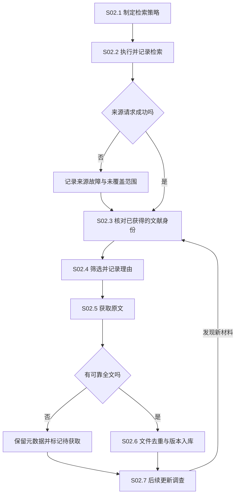

**完成条件：** 无结果与来源失败严格区分；每篇文献具有可核对身份；文件重复与论文版本不是同一个概念。没有全文的条目可参与发现，但不能被标成全文已核验。

**异常处理：** 错误的开放全文链接进入待核对，不借用题名或参考文献冒充目标论文。DOI 冲突、同名不同论文、正式版和预印本由身份规则与人工核对处理，不能只用文件哈希合并。

### S03 解析、质量分区与原文证据定位

**目标：** 使后续引用和分析知道哪些内容可靠、哪些内容仍需对照原文。

**输入：** 原始 PDF、现有解析版本，以及可选其他资料格式。

| 子环节 | 用户与系统行为 | 输出与检查 |
| --- | --- | --- |
| S03.1 固定原始文件版本 | 保存哈希、来源和文件身份 | 可定位的原文版本 |
| S03.2 生成解析候选 | 复用现有解析引擎与回退机制 | 候选结构、正文、图表与公式 |
| S03.3 执行结构检查 | 检查顺序、标题、坐标、编号和引用关联 | 结构问题清单 |
| S03.4 执行科学内容检查 | 检查数字、单位、公式、表格关系等疑点 | 待核对区域与原文对照 |
| S03.5 人工核对关键区域 | 查看原图和候选内容，修正或保留不确定 | 核对记录与修订版本 |
| S03.6 采用解析版本 | 选择用于后续研读与检索的版本 | 采用版本及覆盖说明 |
| S03.7 发布可用证据 | 可靠部分入库，疑点保持可见但限制用途 | 带来源版本、页码和坐标的证据 |

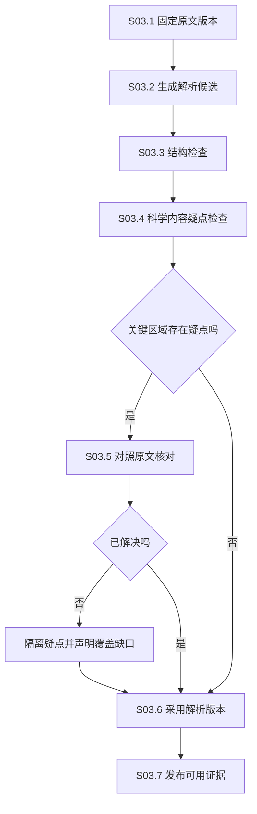

**完成条件：** 每个用于关键判断的引用能找到固定版本原文；部分解析失败不阻断已可靠部分的使用；新候选失败不覆盖之前的可用版本。

**异常处理：** 视觉模型产物保持候选身份，模型通过检查不等于人已核对。扫描件或复杂表格可以只保留图像证据，不伪造结构化数值。

### S04 阅读、研读与结构化知识抽取

**目标：** 从单篇资料获得能够参与课题研究的理解、问题和证据。

**输入：** 文献与采用解析版本、课题问题、阅读目标。

| 子环节 | 用户与系统行为 | 输出与检查 |
| --- | --- | --- |
| S04.1 选择阅读目标 | 判断相关性、理解方法、复现或寻找改进 | 目标与课题关联 |
| S04.2 粗读与取舍 | 查看问题、方法、主要结果和限制 | 阅读卡与深入阅读理由 |
| S04.3 深入阅读 | 按段落、公式、算法和图表理解内容 | 带定位的解释与疑问 |
| S04.4 区分知识类型 | 将摘录、作者结论、AI 解释和个人想法分开 | 类型明确的笔记片段 |
| S04.5 检查理解 | 学习模式进行考查；研究模式自行标记理解缺口 | 学习记录或待解决问题 |
| S04.6 抽取研究要素 | 提取方法条件、数据、指标、局限和复现线索 | 可进入矩阵的结构化候选 |
| S04.7 交接研究成果 | 保存证据卡、问题卡或研究方案草稿 | 关联课题的独立成果 |

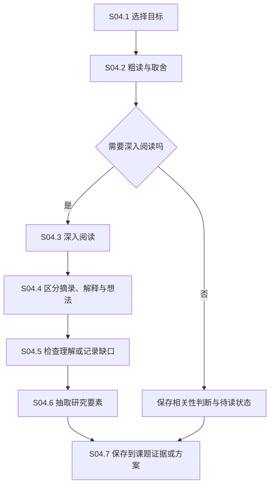

**完成条件：** 笔记能返回原文；个人推断不会显示为作者结论；已有研读任务完成状态保持原有学习含义，另建研究方案承接后续工作。

**异常处理：** 未解决公式或图表解释以问题卡形式留下；更换解析版本不静默改写旧研读所固定的来源。研究模式允许不做学习考查，避免把答题当作开展研究的普遍前提。

### S05 文献矩阵、证据卡与冲突综合

**目标：** 从“读过多篇论文”推进到“能够比较论文并说明证据边界”。

**输入：** 已筛选文献、阅读卡、定位摘录、检索结果。

| 子环节 | 用户与系统行为 | 输出与检查 |
| --- | --- | --- |
| S05.1 定义对比维度 | 按研究问题选择方法、数据、指标、条件、局限等列 | 矩阵模板及字段说明 |
| S05.2 抽取单元格证据 | 从原文填入值，附引用位置与抽取方式 | 每格的来源和确认状态 |
| S05.3 核对比较条件 | 对齐任务、数据划分、指标定义和实验预算 | 可比较、不可直接比较或未知 |
| S05.4 建立证据卡 | 保存一个可单独引用的事实或观察 | 证据正文、适用条件和原文位置 |
| S05.5 处理冲突与缺失 | 保留相反结果，识别条件差异和资料缺口 | 冲突组、未知项和补充任务 |
| S05.6 形成综合判断 | 提出已有共识、尚有争议、研究空白候选 | 带限定条件的综合说明 |
| S05.7 维护更新影响 | 来源更新后标记受影响格、卡片和判断 | 可复核的变更清单 |

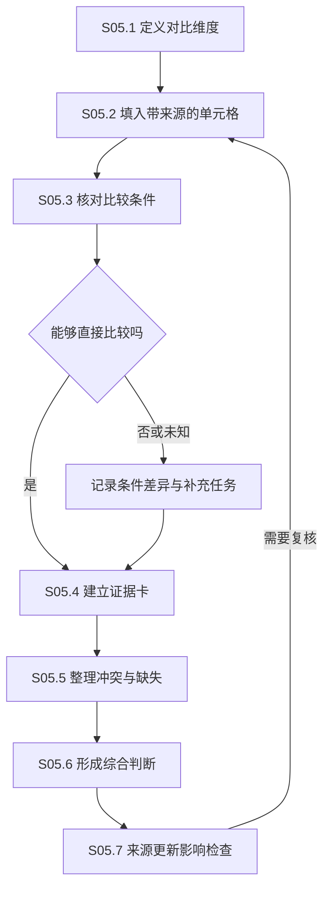

**完成条件：** 关键单元格能跳转来源；没有证据、原文未报告、无法解析和数值为零分别表示；综合结论可以展开支持和反对材料。

**异常处理：** 模型提取的新事实先作为候选。不能因为相似度高就判定结论相同，也不能因为发表时间较新就认定旧结果被推翻。综述模式进一步保留每次抽取与更正的记录。

### S06 初次选题、研究假设与二次选题

**目标：** 将文献调查和已有实验转化为可验证、可取舍的研究方向，并保留为什么选择这个方向。

**输入：** 问题卡、文献矩阵、冲突与缺口、资源约束；二次选题还包括已做实验、失败记录和已有技术栈。

| 子环节 | 用户与系统行为 | 输出与检查 |
| --- | --- | --- |
| S06.1 确定选题起点 | 选择从大方向开始，或从已有课题继续 | 初次或二次选题上下文快照 |
| S06.2 明确来源策略 | 配置时间窗口、来源类别、发表身份与质量要求 | 可说明、可调整的筛选规则 |
| S06.3 生成候选问题 | 针对证据缺口、冲突、应用限制和失败模式形成候选 | 候选问题及其依据 |
| S06.4 整理假设卡 | 写出预测、作用范围、潜在机制、反例和替代解释 | 可证伪假设或理论命题 |
| S06.5 核查新颖性与可行性 | 检查近似工作、代码、数据、资源与验证难度 | 证据充分程度及可行性说明 |
| S06.6 比较与选择 | 按研究价值、证据、验证成本和风险比较 | 选定方向、备选方向、暂缓理由 |
| S06.7 安排最小验证 | 先设计能够支持继续或停止的低成本研究动作 | 下一轮研究方案入口 |

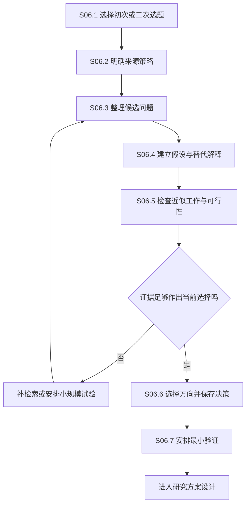

**完成条件：** 每个候选能说清楚研究问题、已有依据、未知部分和验证路径。新颖性判断注明检索范围与日期；证据不足时不宣称全球首次。

**异常处理：** 当前项目中较具体的年份与分区要求应作为可选策略保留，不能成为所有研究类型的固定门槛。二次选题可以选择缩小问题、验证负结果、调整方案或停止，不强制产出一个“新创新点”。

**一期边界：** 建立假设卡和决策记录；复用现有初次选题成果。二次选题的自动综合在形成实验和结论记录后再建设。

### S07 研究方案、数据与验证计划

**目标：** 在执行前明确如何验证问题，并让后续变更能够被辨认。

**输入：** 已选假设、资源约束、可用资料、已有研读生成的实验计划。

| 子环节 | 用户与系统行为 | 输出与检查 |
| --- | --- | --- |
| S07.1 接收与补全计划 | 将研读计划或手写方案转成研究方案草稿 | 保留原始来源的方案 |
| S07.2 定义验证目标 | 设置主要问题、主要指标、预期和失败判据 | 明确的验证目标 |
| S07.3 固定数据与材料 | 登记来源、许可或使用范围、版本、划分与预处理 | 数据清单及适用限制 |
| S07.4 设计对照 | 定义基线、消融、替代解释、负对照或反例 | 对照矩阵与可比较条件 |
| S07.5 定义分析口径 | 指标公式、单位、聚合方式、阈值来源、重复与不确定性报告 | 指标与分析规范 |
| S07.6 安排资源和停止条件 | 预算、预计耗时、试跑范围、失败重试及止损条件 | 执行清单和预算上限 |
| S07.7 审阅与冻结 | 检查关键缺口，保存方案版本 | 可引用的方案快照 |
| S07.8 管理方案变更 | 保存变更时间、理由、是否已观察相关结果 | 修订记录与探索性标记 |

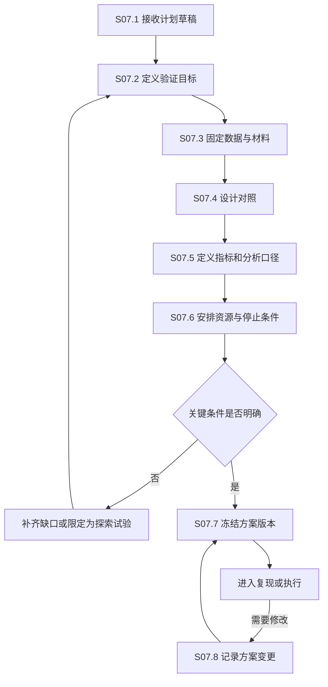

**完成条件：** 执行人员知道输入是什么、比较什么、怎么算、何时停止。数据划分、阈值确定和评价口径能够明确区分。看到结果后改变主指标或筛选规则必须留下记录。

**异常处理：** 缺少完整环境和许可信息时显示缺口及允许的使用范围。数据集过大时登记版本、清单和校验信息，不要求复制全部数据。无法进行重复实验时保留理由，不能自动补造统计结果。

**模式差异：** 综述模式固定检索与筛选、抽取规范；理论模式固定定义、前提、命题和证明目标；不适用的随机种子、GPU 等字段不强制填写。

### S08 基线复现与比较条件对齐

**目标：** 在解释改进有效性之前，清楚知道当前基线与参考结果的关系。

**输入：** 原论文与官方实现线索、研究方案、数据和环境。

| 子环节 | 用户与系统行为 | 输出与检查 |
| --- | --- | --- |
| S08.1 提取参考条件 | 区分论文设置、仓库设置和用户实际设置 | 三方条件对照表 |
| S08.2 检查关键差异 | 数据版本、划分、预处理、训练轮次、批量、评估代码等 | 已知差异及未知项 |
| S08.3 执行小规模验证 | 确认数据读取、前向输出、训练和指标计算基本一致 | 小规模运行记录 |
| S08.4 登记正式复现 | 固定实际代码、配置与环境，登记基线运行 | 基线结果与运行来源 |
| S08.5 比较复现差距 | 按一致的指标定义比较原文与自有结果 | 差距表与口径说明 |
| S08.6 排查与单项验证 | 将原因假设转成可检查动作，保留排查证据 | 被支持、被排除和未知原因 |
| S08.7 决定后续用途 | 标记可比较、有限可比较、未对齐或不适用 | 明确的基线使用范围 |

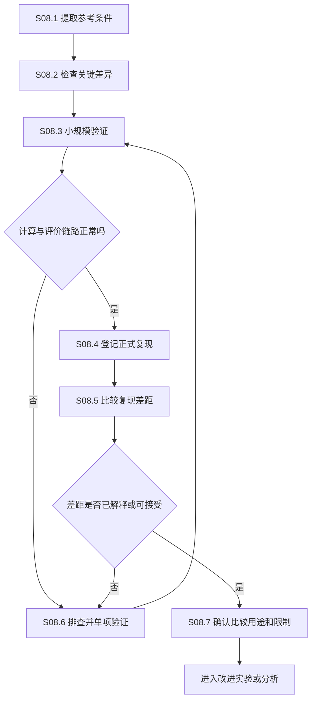

**完成条件：** 原文结果与本地结果有明确区分；比较容差根据任务预先说明；原始基线、修正基线和改动后的基线分别记录。

**异常处理：** 长期无法对齐时允许停止、求助或开展带限制的探索，不无限循环消耗预算。发现评价脚本错误时，应将受影响运行的分析结果标记待重算；不能据此自动认定训练错误也已解决。

### S09 研究执行、运行记录与失败管理

**目标：** 保存实际做过的每次尝试及其输入输出，使运行与假设、方案和成果相连。

**输入：** 固定方案、可选基线、数据清单、代码版本和执行环境。

| 子环节 | 用户与系统行为 | 输出与检查 |
| --- | --- | --- |
| S09.1 创建逻辑实验 | 关联待验证假设和方案版本，定义实验组 | 实验身份和比较分组 |
| S09.2 选择接入方式 | 手动登记、CSV/JSON 导入、运行目录关联；后续可接跟踪服务 | 明确的记录来源 |
| S09.3 建立运行快照 | 保存代码版本、未提交变更说明、配置、数据、环境和种子 | 每次运行的输入快照 |
| S09.4 预检查并执行 | 首期用户在已有环境执行；平台显示准备状态 | 启动记录及外部运行引用 |
| S09.5 收集过程数据 | 保存日志、指标、资源用量、检查点和错误 | 时间序列与过程产物 |
| S09.6 接收最终产物 | 导入结果表、模型、图像或其他成果 | 文件校验、身份和归属 |
| S09.7 结束核对 | 判断成功、失败、中止或记录不完整 | 实际终态和缺失项 |
| S09.8 重试与续跑 | 记录上一次尝试、恢复点、参数和状态是否改变 | 新尝试及续跑关系 |

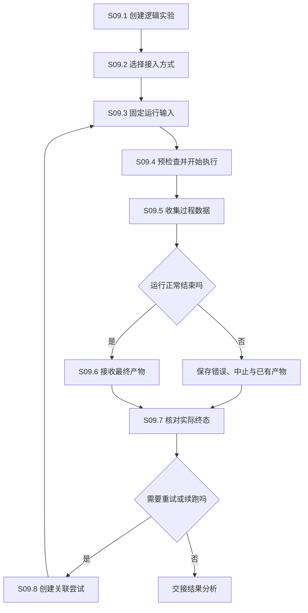

**完成条件：** 成功和失败都形成可查看记录；每次结果对应具体运行；导入的指标必须有名称、值、口径和来源位置。缺失信息明确显示“未记录”。

**异常处理：** 日志停止不自动认定外部进程已退出；网络断开与计算失败分别记录。重试不得覆盖失败运行；恢复训练若改变优化器状态、配置或数据，需要新尝试并说明差异。

**一期边界：** 不新增远程服务器控制、自动部署或全自动训练平台。先确保用户现有脚本、CSV 和结果目录能进入研究链路。后续运行连接器必须另行定义取消、凭据、权限、心跳和断连恢复语义。

### S10 结果分析、假设判断与结论维护

**目标：** 从运行产物形成条件明确、证据充分且能够修订的研究判断。

**输入：** 运行记录、原始结果、指标规范、研究方案和文献证据。

| 子环节 | 用户与系统行为 | 输出与检查 |
| --- | --- | --- |
| S10.1 检查结果完整性 | 核对缺失、失败样本、重复记录和文件一致性 | 可分析范围与缺失说明 |
| S10.2 校验评价口径 | 校验列映射、公式、单位、阈值、聚合和数据划分 | 指标规范对应关系 |
| S10.3 建立比较组 | 按方法、数据、预算和条件筛选可比较运行 | 显式纳入与排除理由 |
| S10.4 生成分析快照 | 计算描述统计、差异、适用的不确定性分析和失败案例 | 分析版本及输入运行集合 |
| S10.5 对照原假设 | 检查支持证据、反证、替代解释和适用范围 | 支持、未支持、反对或尚不明确的判断 |
| S10.6 建立结论卡 | 写出准确表述、证据关系、限制和核对记录 | 可用于写作的结论候选 |
| S10.7 决定下一步 | 继续验证、修改假设、形成成果或停止 | 决策记录和后续行动 |
| S10.8 处理后续更正 | 输入或口径变化后检查结论与稿件影响 | 待复核、替代或撤回记录 |

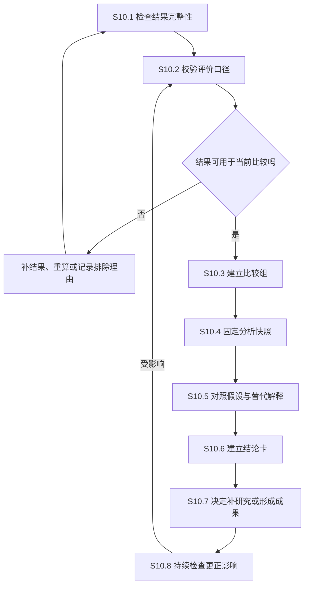

**完成条件：** 每个关键数值能回到运行和分析输入；每条结论注明证据、范围与限制。统计显著、效果大小、实际意义和因果解释分别表达，不由一个“有效”标签代替。

**异常处理：** 不允许自动隐藏失败种子、不理想子集和负结果。探索性发现可以保留并生成新假设；不能倒写成实验前就已确定的主假设。新的反证将结论标为需要复核，不自动判定所有历史结论错误。

### S11 科研图表、结果表与成果材料

**目标：** 让图表从已核对的数据和结论生成，并保留展示方式与数据处理过程。

**输入：** 分析快照、结论卡、原始图像和目标稿件要求。

| 子环节 | 用户与系统行为 | 输出与检查 |
| --- | --- | --- |
| S11.1 确定图表目的 | 明确要展示的问题、比较或方法 | 对应结论和目标读者 |
| S11.2 选择数据来源 | 选定分析快照、运行与必要原图 | 固定来源集合 |
| S11.3 设计呈现方式 | 选择图型、单位、坐标范围、误差表示和分组 | 图表设计记录 |
| S11.4 生成与编辑 | 导入或生成图表，保存源数据与生成材料 | 可编辑成果与版本 |
| S11.5 核对内容 | 检查标签、数值、样本数、图注和比较条件 | 内容核对记录 |
| S11.6 导出与引用 | 生成需要的图片、矢量文件、表格或补充材料 | 导出版本及稿件关联 |
| S11.7 处理数据变化 | 上游分析变化后比较影响 | 待更新提示或新图表版本 |

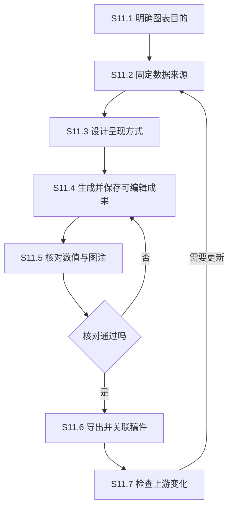

**完成条件：** 稿件中的图表能追溯到生成数据；数值舍入、平滑、截断和其他处理有记录；方法示意图与实测结果图分别标识。

**异常处理：** 只有图片、缺少源数据的外部结果可以保存，但显示可追溯性限制。改配色或布局不改变科学数据；修改数据处理方法必须产生新的分析或处理记录。

### S12 稿件规划、写作、引用与一致性检查

**目标：** 用已经形成的研究证据组织稿件，让文字、图表、引文和研究结果一致。

**输入：** 问题卡、研究方案、结论卡、图表、文献元数据和目标稿件类型。

| 子环节 | 用户与系统行为 | 输出与检查 |
| --- | --- | --- |
| S12.1 建立稿件 | 选择 Markdown、LaTeX 或外部稿件关联，设置文章类型 | 稿件身份与工作文件 |
| S12.2 规划论证结构 | 将问题、贡献、方法和结果分配到章节 | 章节目标与证据需求 |
| S12.3 编写并关联结论 | 手写或 AI 辅助草稿，关键论断连接结论卡 | 可检查来源的稿件段落 |
| S12.4 插入文献引用 | 从文献库选择条目，维护引用键和版本 | 引用条目、引用位置与书目 |
| S12.5 插入图表与补充材料 | 关联已核对成果，维护编号和交叉引用 | 稿件中的成果使用记录 |
| S12.6 修订与核对 | AI 修改显示差异；检查数字、术语、引用和结论范围 | 修订记录与待处理问题 |
| S12.7 编译或导出 | 按选定格式生成预览和交付文件 | 构建结果、错误和文件清单 |
| S12.8 冻结稿件版本 | 核对当前内容后形成不可变快照 | 可用于内部审阅或投稿的版本 |

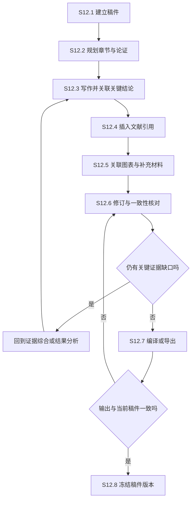

**完成条件：** 引用键稳定且冲突可处理；缺失引用、重复条目、未被引用的图表和过期结论有检查入口；编译失败不能拿旧 PDF 冒充本次成功结果。

**引用管理细节：**

- 论文身份、文献元数据版本、原文证据位置和稿件引用键分别管理。
- 元数据更新先显示差异；当前工作稿可接受更新，历史投稿书目快照保留。
- 多个稿件使用同一文献时可以共享文献身份，但各自保存发布时使用的元数据。
- `.bib` 导出与普通文本引用不等于 Word 中可动态更新的引用字段。Word 深度集成应作为独立适配器验收，不在第一版导出中暗示已经支持。
- 关键段落的证据关联采用独立记录与可重定位锚点，避免只靠容易变化的行号。

**异常处理：** 从外部编辑器修改后，失配的段落锚点显示待重新关联；AI 改写涉及数字、否定、比较对象或结论强度时重点提示核对。

### S13 投稿、审稿意见与修订循环

**目标：** 保存提交了什么、收到什么反馈、如何修改以及补充了哪些研究。

**输入：** 冻结稿件版本、目标期刊或会议、图表与补充材料。

| 子环节 | 用户与系统行为 | 输出与检查 |
| --- | --- | --- |
| S13.1 登记投稿目标 | 保存目标渠道、材料要求、时间及信息来源 | 带核对日期的投稿目标 |
| S13.2 检查投稿材料 | 检查稿件、图表、补充材料和必要声明是否齐全 | 材料清单与缺失项 |
| S13.3 冻结投稿包 | 保存将要提交的确切文件、清单与校验值 | 投稿包快照 |
| S13.4 登记提交结果 | 用户手动提交后记录日期、编号和回执 | 真实提交事件 |
| S13.5 拆解审稿意见 | 按意见逐条分类：解释、改写、补证据、补实验等 | 可执行的修订任务 |
| S13.6 处理修订 | 关联实验、分析、稿件修改位置和回复草稿 | 意见到证据到修改的对应关系 |
| S13.7 核对回复与重投 | 检查每条意见的处置、回复和稿件是否一致 | 修订稿与回复包 |
| S13.8 登记最终结果 | 保存录用、拒稿、撤稿申请或改投等实际事件 | 本轮结局及后续路线 |

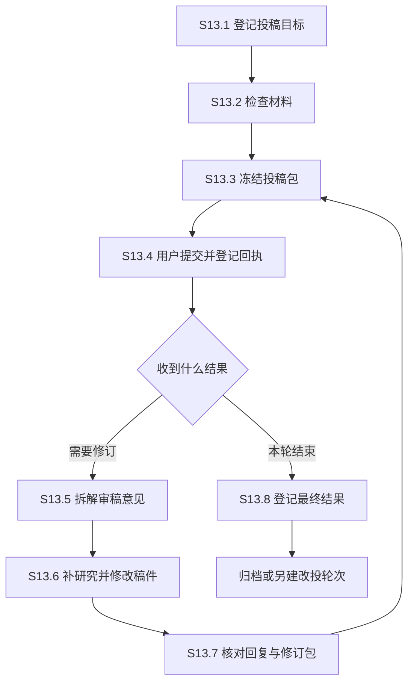

**完成条件：** 每条审稿意见有处置状态、理由和修改位置；提交版本与回执明确关联；“准备完成”和“已经提交”分别显示。

**异常处理：** 导入邮件或粘贴审稿意见只创建草稿，不自动对外回复。目标渠道要求需在准备提交时重新核对。改投新建投稿轮次，不覆盖上一轮记录。

### S14 归档、复盘、成果复用与二次研究

**目标：** 使完成或停止的课题可恢复、可引用、可继续，并保留负结果与未解决问题。

**输入：** 课题内容、投稿结果、最终稿件、研究记录和外部资源引用。

| 子环节 | 用户与系统行为 | 输出与检查 |
| --- | --- | --- |
| S14.1 确认归档范围 | 选择课题、研究周期或一次投稿轮次 | 归档边界与排除清单 |
| S14.2 检查来源完整性 | 核对原文、方案、运行、数据清单、分析与稿件 | 缺失文件和断开关联报告 |
| S14.3 制作归档包 | 固定内容快照、版本清单与校验信息 | 可移植归档包 |
| S14.4 恢复验证 | 在独立位置检查可读性和主要关系 | 恢复验证记录 |
| S14.5 研究复盘 | 总结有效方法、失败尝试、局限和判断变化 | 项目复盘与可复用经验 |
| S14.6 提取后续问题 | 从限制、未解释结果和新文献提取下一轮问题 | 二次选题候选 |
| S14.7 创建研究分支 | 复用有明确来源的历史材料，建立新问题与版本 | 新课题或新研究周期 |

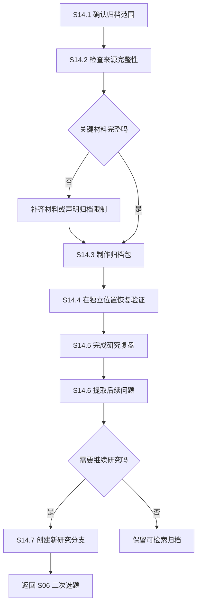

**完成条件：** 归档包标注内容是否齐全、外部数据是否包含、恢复是否经过验证。课题归档不等于删除，外部资源不可用也不能静默变成完整归档。

**异常处理：** 包含受限数据时支持清单与引用方式归档，记录缺少数据会影响的复现步骤。对外共享与内部归档分别执行；归档不自动公开文件或创建外部发布记录。

## 四、六项贯穿全流程的支撑能力

### X01 后台任务、成本预算与中断恢复

**服务范围：** 文献解析、入库、选题、图表生成、模型分析，以及未来的外部研究运行连接器。

| 子环节 | 设计内容 | 验收要点 |
| --- | --- | --- |
| X01.1 任务预检 | 核对输入版本、服务、权限与必要配置 | 缺失条件可定位，不先消耗大量调用 |
| X01.2 成本说明 | 展示可估算的费用、工作量和不确定部分 | 未知费用显示未知，不填零 |
| X01.3 排队与配额 | 按资源和任务类型控制并发与预算 | 重复提交有明确处置 |
| X01.4 执行与检查点 | 记录阶段、用量、可恢复点和实际错误 | 页面关闭不丢失已保存结果 |
| X01.5 暂停与取消 | 根据能力显示可暂停、可取消或等待结束 | 不能伪造外部任务已停止 |
| X01.6 发布检查 | 核对输入、任务代次、删除和过期状态 | 迟到结果不覆盖更新成果 |
| X01.7 恢复与结算 | 从有效检查点恢复，归集实际用量 | 重试关联原任务，费用可解释 |

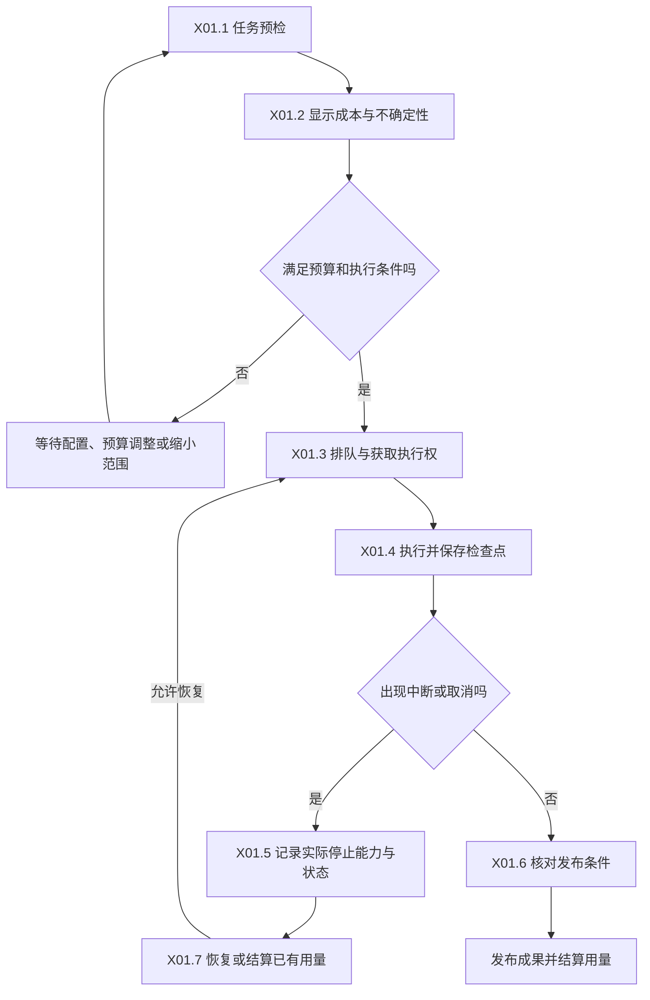

**关键边界：** 软件后台任务沿用已有状态体系；实验 Run 的成功与失败有独立领域含义。费用统计同时保留币种、计价来源和估算或实际属性。多进程运行前另行落实租约、心跳、竞争和跨进程取消，不能直接复用进程内登记充当分布式执行保障。

### X02 完整备份、迁移与恢复演练

**服务范围：** 应用资料、研究记录、稿件、会话、受管原文、来源关系和必要配置描述。

| 子环节 | 设计内容 | 验收要点 |
| --- | --- | --- |
| X02.1 选择备份范围 | 全部资料或指定课题；区分受管与外部文件 | 包含、排除、外部引用均有清单 |
| X02.2 形成一致快照 | 协调数据库、对象文件、会话和正在写入的成果 | 备份对应明确一致性边界 |
| X02.3 打包与校验 | 记录版本、哈希、体积和依赖 | 损坏文件可定位 |
| X02.4 选择恢复位置 | 默认恢复到独立目录；处理同名和身份冲突 | 不直接覆盖当前工作资料 |
| X02.5 检查兼容与恢复 | 检查格式版本，恢复文件和关系 | 不兼容时保留原包并说明原因 |
| X02.6 重接外部能力 | 重新定位外部目录、凭据和可重建索引 | 阅读可先恢复，检索恢复单列 |
| X02.7 验证与留存 | 打开代表性资料、跳转引用、检查稿件 | 形成恢复报告及轮换记录 |

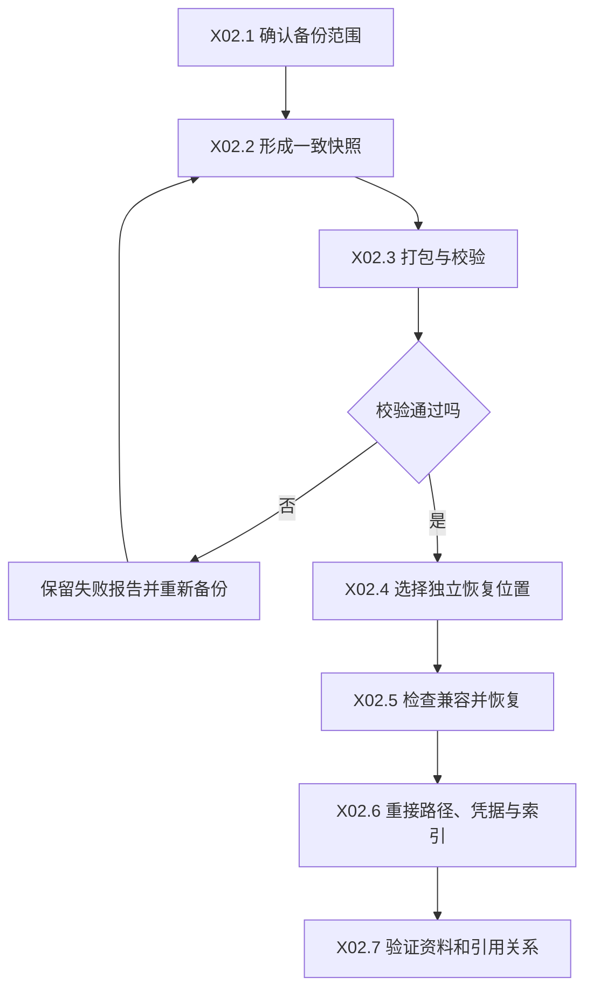

**关键边界：** 回收站、历史版本和迁移备份继续保留，但完整备份需要独立验收。凭据默认不进入普通课题导出包；保存所需服务名称与重新配置提示。向量索引可选择备份或重建，重建成本与索引配置必须说明，模型无法恢复时也应能查看原文与历史成果。

### X03 科研质量评测与回归验收

**服务范围：** 解析、检索、引用、综合分析、实验数据导入、稿件检查和完整用户路径。

| 子环节 | 设计内容 | 验收要点 |
| --- | --- | --- |
| X03.1 建立真实案例集 | 使用具有授权的多篇真实资料和研究案例 | 覆盖普通、困难、无答案与冲突情况 |
| X03.2 建立人工参考 | 记录正确证据位置、可接受答案与不能推断的内容 | 参考答案本身可复查 |
| X03.3 划分开发与保留集 | 日常调试样例与发布检验样例分开 | 避免反复针对同一题集调参 |
| X03.4 执行分层评测 | 分别测试软件正确性、科学内容质量和用户流程 | 不把单元测试通过当作科学质量证明 |
| X03.5 比较质量与成本 | 比较引用、数值、无证据处理、延迟与费用 | 保存模型和配置版本 |
| X03.6 分析错误与修订 | 定位到解析、召回、推断、展示或数据导入 | 有明确负责环节与修复范围 |
| X03.7 发布判定 | 按预设门槛决定通过、有限发布或退回 | 留下验收记录和已知限制 |

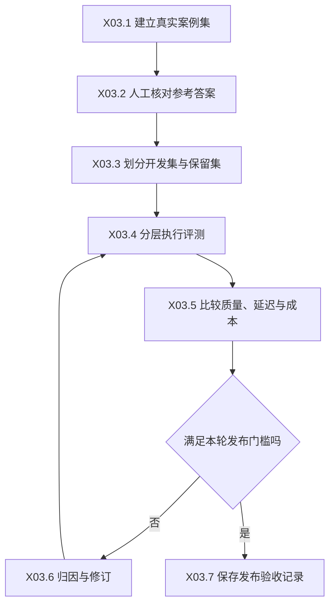

**建议起步规模：** 首个领域先选取约 30—50 篇具有不同版式的论文、约 100—150 个经人工核对的问题，再增加 10 个左右真实研究流程案例。数量是规划建议，需根据标注成本调整；冻结测试集后再确定能支撑的质量结论。

**门槛分层：**

- 数据完整性：发布快照、运行身份和关键来源关系应全部可定位；存在缺失时阻止宣称完整。
- 科学质量：引用支持率、数字正确率、无答案处理等阈值先在基线评测后确定，不虚构当前水平。
- 产品流程：导入到引用、计划到结果、修改到影响提示、备份到恢复等核心路径必须通过。
- 性能成本：按材料规模和机器配置建立基线，记录较长耗时任务及退化原因，避免给出无条件时延承诺。

### X04 来源关系、版本、过期与删除恢复

**服务范围：** 全部科研对象及其“使用、支持、反对、生成、替代、引用”等关系。

| 子环节 | 设计内容 | 验收要点 |
| --- | --- | --- |
| X04.1 登记对象身份 | 分离对象身份、内容版本和业务归属 | 同一文件可被多个课题引用 |
| X04.2 记录依赖关系 | 下游对象指向实际使用的来源版本 | 有方向、有关系类型 |
| X04.3 处理内容更新 | 创建新版本，识别固定引用与跟随当前版本的关系 | 历史快照不会被静默改写 |
| X04.4 计算影响范围 | 定位受影响的卡片、分析、图表和稿件 | 仅标记实际相关对象 |
| X04.5 复核或重建 | 用户选择保留历史、更新或重做 | 每次处置保留理由 |
| X04.6 删除与回收 | 检查共享、快照与外部引用，撤销迟到发布 | 不删除不归应用所有的源文件 |
| X04.7 恢复与修复 | 恢复对象并核对版本、路径和关系 | 不以文件存在代替完整恢复 |

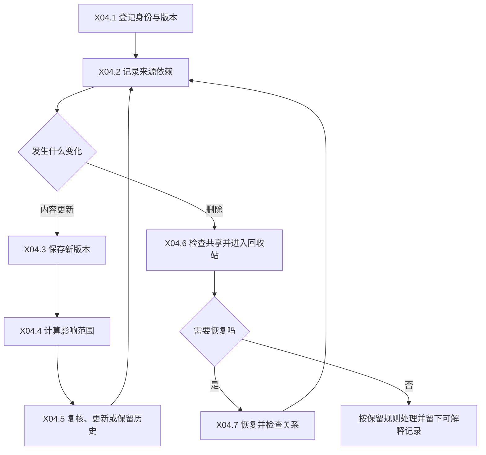

**关键边界：** 文件失效、来源过期、结论需要复核和结论被撤回分别表示。新版本不自动推翻旧结论；物理删除也不能把已有引用静默改指另一篇文献。研究语义关系与现有存储清理关系分层，防止“支持某结论”被误解成“删除来源就级联删除全部研究历史”。

### X05 小课题组协作与角色分工

**服务范围：** 在个人版闭环稳定后启用的团队课题、评论、审阅与共享成果。

| 子环节 | 设计内容 | 验收要点 |
| --- | --- | --- |
| X05.1 确认部署与成员边界 | 明确账号、团队和数据存放位置 | 本地单人配置与团队模式分开 |
| X05.2 分配项目角色 | 管理者、编辑者、审阅者、查看者 | 服务端执行权限检查 |
| X05.3 分配研究任务 | 明确负责人与预期成果 | 任务状态可关联证据和成果 |
| X05.4 评论与审阅 | 对问题、证据、运行、图表和稿件评论 | 评论定位到具体对象与版本 |
| X05.5 处理并发修改 | 展示冲突、保留双方草稿和历史 | 不静默覆盖他人修改 |
| X05.6 共享与撤回 | 指定对象、版本、范围和可见内容 | 来源权限不因引用自动扩大 |
| X05.7 审计与成员退出 | 记录操作与责任，移交任务与成果 | 人员退出后研究记录仍完整 |

```mermaid
flowchart TD
    A["X05.1 明确团队与部署边界"] --> B["X05.2 配置项目角色"]
    B --> C["X05.3 分配研究任务"]
    C --> D["X05.4 评论与审阅"]
    D --> E{"发生编辑冲突吗"}
    E -->|是| F["X05.5 保留双方修改并解决冲突"]
    F --> D
    E -->|否| G["X05.6 明确共享范围"]
    G --> H["X05.7 保存审计与移交记录"]
```

**关键边界：** 现有 revision 冲突检测可以作为基础，但不等于已实现团队协作。首个团队版本可采用版本冲突解决与评论，不要求同时实现实时多人文档编辑。外部发送、发布和共享作为明确的用户动作。

### X06 工作区导航、全局查找与日常恢复

**服务范围：** 主页面、独立研读、选题、视频、写作和未来实验页面。

| 子环节 | 设计内容 | 验收要点 |
| --- | --- | --- |
| X06.1 明确当前上下文 | 显示课题、研究对象、来源版本与所处阶段 | 不依赖用户猜测当前作用范围 |
| X06.2 提供任务入口 | 根据当前目标进入阅读、证据、实验或稿件 | 从产物直接进入下一环节 |
| X06.3 全局查找 | 按对象类型查找文献、结论、运行、图表和稿件 | 搜索结果区分类型与归属 |
| X06.4 保留工作现场 | 保存布局、草稿、筛选、滚动和未完成动作 | 切换工作区后可恢复 |
| X06.5 展示需要处理的变化 | 汇总来源更新、失败任务、评论和下一步 | 提醒有原因、对象和处理动作 |
| X06.6 恢复研究 | 根据真实记录展示上次停在哪里 | 摘要可展开原始事件 |

```mermaid
flowchart TD
    A["X06.1 确认当前课题与对象"] --> B["X06.2 选择当前研究任务"]
    B --> C["X06.3 查找需要的材料"]
    C --> D["执行阅读、记录、分析或写作"]
    D --> E["X06.4 保存工作现场"]
    E --> F["X06.5 汇总需处理的变化"]
    F --> G["X06.6 下次恢复研究上下文"]
    G --> B
```

**关键边界：** 默认检索当前课题，扩展到全库应清楚提示范围；这是产品范围选择，团队模式还需要独立权限过滤。提醒先进入应用内收件箱，定时推送与外部通知后续按用户设置启用。

## 五、页面与跨环节交接设计

### 5.1 页面信息架构

保留当前阅读、研读、选题、视频与写作入口，在其上增加明确的课题上下文。新能力优先围绕课题组织，避免每增加一种对象就增加一个全局工具按钮。

| 页面或区域 | 应显示的主要内容 | 高频操作 | 首期范围 |
| --- | --- | --- | --- |
| 工作台首页 | 最近课题、上次工作、需要处理的变化 | 恢复课题、创建课题、全局查找 | 必需 |
| 课题总览 | 问题、阶段、关键假设、最新结果、阻塞与下一步 | 更新问题、关联成果、记录决定 | 必需 |
| 文献与阅读 | 文献状态、原文、解析质量、笔记、选区 | 阅读、核对、保存证据 | 复用现有 |
| 证据工作区 | 文献矩阵、证据卡、支持与反对材料 | 比较、核对、生成假设草稿 | 必需 |
| 研究设计 | 假设、方案版本、对照、指标、资源与停止条件 | 冻结方案、变更方案、建立实验 | 必需 |
| 实验工作区 | 基线、逻辑实验、运行、产物、失败与续跑 | 导入结果、对齐口径、比较运行 | 必需，先导入 |
| 结论与图表 | 分析快照、结论卡、图表来源及状态 | 核对、关联稿件、查看影响 | 必需 |
| 稿件工作区 | 章节、正文、引用、图表、证据与版本 | 插引用、检查、导出、冻结 | 扩展现有 |
| 投稿与修订 | 投稿轮次、文件包、意见与修改位置 | 登记回执、拆解意见、完成回复 | 后续 |
| 项目时间线 | 决策、方案修改、运行完成、结论修订等 | 查历史、定位来源 | 先做基础事件 |
| 资料与任务 | 资源、任务、待核对、回收站、备份 | 重试、恢复、备份、检查关系 | 复用并扩展 |
| 视频资料 | 视频身份、来源、时间戳、摘帧与分析 | 保存时间段证据、关联课题 | 后续 |
| 团队空间 | 成员、角色、任务、评论、共享 | 分配、审阅、权限管理 | 团队阶段 |

### 5.2 课题首页的具体布局

从上至下建议分成五块：

1. **课题身份与问题：** 名称、研究类型、当前问题、当前研究周期、负责人与最后更新时间。
2. **当前工作：** 当前阶段、阶段目标、最近完成事项和下一步动作；动作必须有明确对象。
3. **研究证据：** 关键假设、支持与反对证据、尚未核对的关键内容。
4. **最新成果：** 最近运行、分析结论、图表和稿件版本；点击可进入对应工作区。
5. **变化与阻塞：** 来源更新、评价口径改变、缺失文件、失败任务和待处理评论。

不使用缺少定义的“科研完成度 85%”。可以展示具有明确分母的项目，例如“本轮 8 条待核对意见，已处理 5 条”；阶段完成由该阶段的交付条件决定。

### 5.3 跨环节交接合同

每次交接至少保存：来源对象、来源版本、目标课题、目标对象、发起动作、时间和处理状态。目标对象可编辑，来源快照保持可追溯。

| 起点与动作 | 终点 | 必须带过去的上下文 | 需要用户补充或确认 |
| --- | --- | --- | --- |
| 从选题方向建立课题 | S01 | 方向、报告版本、引用、约束 | 课题名称和当前问题 |
| 将检索结果加入课题 | S02 | 文献身份、来源、检索批次 | 已有论文版本的合并选择 |
| 将阅读选区保存为证据 | S05 | 原文版本、页码、坐标、上下文 | 证据类型与适用条件 |
| 将文献矩阵发现转为假设 | S06 | 涉及的单元格、冲突和缺口 | 可验证预测与反例 |
| 将研读计划转为研究方案 | S07 | 固定研读版本、假设、对照和指标 | 实际数据、环境和评价口径 |
| 从方案建立实验 | S08/S09 | 方案版本、目标、数据、对照、预算 | 实际执行配置 |
| 从运行建立分析 | S10 | 运行版本、产物、指标规范 | 比较组与排除理由 |
| 从分析生成图表 | S11 | 分析快照、数据表、对应结论 | 展示方式、图注与舍入 |
| 将结论用于稿件 | S12 | 结论版本、支持和反对证据、限制 | 最终表述与引用选择 |
| 从稿件建立投稿轮次 | S13 | 稿件、书目、图表和补充材料快照 | 投稿目标和材料要求 |
| 将审稿意见转为实验 | S07/S09 | 意见身份、稿件版本、待验证问题 | 补充方案及时间范围 |
| 从复盘启动二次选题 | S06 | 已确认结论、负结果、未解问题、约束变化 | 新研究范围 |

```mermaid
flowchart LR
    A["来源对象与固定版本"] --> B["发起交接动作"]
    B --> C["选择目标课题与对象"]
    C --> D["预览带入内容和缺失项"]
    D --> E["补充目标环节必需信息"]
    E --> F["创建目标草稿及来源关联"]
    F --> G["进入目标工作区继续处理"]
```

**交接异常规则：** 重复点击不能创建无法辨认的重复对象；来源被删除或版本不可访问时交接失败并保留当前草稿；切换课题后不可继续使用旧页面隐含的课题身份。

### 5.4 空状态、错误与工作现场

| 情况 | 应显示什么 | 用户可执行的动作 |
| --- | --- | --- |
| 课题没有文献 | 当前问题与可用导入入口 | 导入、搜索或关联已有文献 |
| 只有题录没有全文 | 已有元数据与全文缺口 | 添加原文、继续题录筛选 |
| 模型服务不可用 | 受影响能力、已保存内容和错误原因 | 手动编辑、稍后重试、更改配置 |
| 实验缺少环境信息 | 已导入结果和未记录字段 | 补录、限定结果用途 |
| 文件外部移动 | 对象仍存在，路径失效 | 重新定位并核对文件身份 |
| 证据或分析过期 | 改变的来源、影响对象和旧版本 | 保留历史、更新、重做或说明无影响 |
| 存在并发编辑冲突 | 当前版本、用户草稿和差异 | 合并、另存版本、重新载入 |
| 任务取消未真正结束 | 停止请求、实际外部状态和已有结果 | 等待、查看外部环境、核对终态 |

## 六、研究对象、版本与状态设计

### 6.1 最小研究对象清单

以下为业务概念设计，不指定数据库表结构，也不要求一次性实现全部对象。

| 对象 | 核心信息 | 关键关联 |
| --- | --- | --- |
| 课题 Project | 身份、问题、研究类型、约束、阶段、目标 | 文献、假设、方案、稿件与研究周期 |
| 研究周期 ResearchCycle | 本轮问题范围、起止、目标与决定 | 同一课题内不同阶段的研究 |
| 问题卡 Question | 研究对象、问题、范围、重要性与版本 | 课题、假设、来源 |
| 文献 Work | 标题、作者、发表身份、DOI、元数据版本 | 多个原文文件与正式版关系 |
| 资料版本 SourceVersion | 文件身份、内容哈希、获取来源和时间 | 文献、解析版本、外部引用 |
| 证据 Evidence | 原文位置、内容、类型、适用条件、核对状态 | 文献、表格单元格、实验或其他来源 |
| 文献矩阵 Matrix | 模板、列定义、单元格值、来源和确认状态 | 文献与证据 |
| 假设 Hypothesis | 预测、机制、反例、替代解释、范围 | 问题、方案、支持与反对证据 |
| 研究方案 Protocol | 目标、数据、对照、指标、预算、停止条件 | 假设、冻结版本、修订记录 |
| 数据版本 DatasetVersion | 来源、使用范围、版本、划分、预处理与校验 | 方案、运行和分析 |
| 指标规范 MetricSpec | 定义、单位、方向、阈值、聚合和计算版本 | 方案、结果、分析与图表 |
| 逻辑实验 Experiment | 目的、实验组和可比较条件 | 方案、基线、多个运行 |
| 运行 Run | 实际配置、代码、环境、开始结束、终态与尝试关系 | 实验、输入版本、产物 |
| 分析 Analysis | 输入运行集合、规则、计算材料、结果和限制 | 指标规范、结论、图表 |
| 结论 Claim | 准确表述、适用范围、支持与反证、核对记录 | 问题、假设、证据、分析和稿件 |
| 成果 Artifact | 图表、表格、模型、笔记等内容与版本 | 来源、生成记录、稿件使用位置 |
| 稿件 Manuscript | 文本、章节、引用、图表和工作版本 | 结论、书目、投稿快照 |
| 稿件使用记录 Usage | 段落或图表锚点、使用对象与版本 | 稿件和证据、结论、成果 |
| 投稿轮次 Submission | 目标、文件快照、回执、状态与日期 | 稿件、审稿意见和修订 |
| 决策 Decision | 当时的问题、选项、依据、选择和理由 | 上述任意对象 |

### 6.2 核心关系图

```mermaid
flowchart TD
    P["课题与研究周期"] --> Q["研究问题"]
    P --> W["文献与资料版本"]
    W --> E["原文证据与文献矩阵"]
    Q --> H["研究假设"]
    E --> H
    H --> R["研究方案版本"]
    R --> X["逻辑实验"]
    D["数据、代码、环境与指标规范"] --> U["具体运行与产物"]
    X --> U
    U --> A["分析快照"]
    A --> C["结论卡"]
    E --> C
    A --> F["图表与成果"]
    C --> M["稿件与使用位置"]
    F --> M
    W --> M
    M --> S["投稿轮次与归档包"]
```

箭头表示主要来源或组织关系，不表示全部都是物理存储所有权。实际关系应具有类型，如“支持”“反对”“使用”“生成”“替代”“引用”“属于”。

### 6.3 版本与引用规则

1. **对象 ID 稳定。** 改名、移动或内容更新不改变研究对象身份。
2. **正式使用固定版本。** 分析、图表、稿件冻结时保存实际使用的输入版本。
3. **草稿可以跟随当前版本。** 需要显示跟随策略及最近更新，用户可以固定版本。
4. **元数据更正单独处理。** 修改作者拼写不等同于正文证据改变，但会影响引用输出。
5. **允许共享与独立快照并存。** 同一文献在多个课题中共享，已归档成果保留使用时的来源说明。
6. **来源缺失可解释。** 缺少文件时仍显示对象身份、已保存的来源信息和缺失原因，不跳转到无关对象。
7. **关系可反查。** 从来源查看使用它的分析和稿件；从稿件回到原文、运行或图表数据。
8. **人工决定有版本。** 结论的确认、降级、替代和撤回记录理由与影响范围。

### 6.4 四类状态轴

| 状态轴 | 示例 | 不应混淆的事项 |
| --- | --- | --- |
| 资源生命周期 | 正常、回收站、清理中、已清理 | 清理与研究结论真假无关 |
| 内容可用性 | 可用、生成中、过期、待核对、缺失、损坏 | 过期不等于错误 |
| 后台执行状态 | 排队、运行、暂停、等待配置、中断、成功、失败、取消 | 后台成功不等于研究成功 |
| 研究领域状态 | 方案草稿或冻结；假设待检验；结论待复核；投稿待回复等 | 各对象有独立含义，不套统一百分比 |

在研究领域内继续区分三个属性：

- **判断内容：** 当前证据支持、未支持、反对或尚不明确。
- **核对状态：** AI 建议、人工已核对、需要再次核对。
- **使用状态：** 草稿、用于当前稿件、历史使用、已替代或已撤回。

例如一条负结果可以同时是“未支持原假设”“人工已核对”“已用于稿件”，三个属性没有矛盾。

### 6.5 旧数据兼容与未来迁移边界

后续实施应先设计兼容规则，再开始任何数据迁移：

| 既有数据 | 规划中的处理 |
| --- | --- |
| 现有项目 | 保持 ID，新增研究信息为空，不自动生成研究事实 |
| 文献与解析 | 保持原身份和版本；新增论文实体关系时提供合并预览 |
| 研读完成记录 | 继续表示研读已完成，关联新方案不会改成研究已结束 |
| 选题报告 | 保留独立快照；用户选择后关联课题或建立问题卡 |
| Markdown 笔记 | 保持原路径或兼容引用；新增结构化对象可以引用原笔记 |
| Pi 会话 | 保持原会话文件；课题关联与研究对象关系由应用管理 |
| 外部 LaTeX 工作区 | 继续按外部文件处理；纳入备份或迁移需明确选择 |
| 根目录已有实验脚本与结果 | 用户主动选择后登记，不自动执行、移动或清理 |

**迁移验收：** 有只读预览、备份、兼容路径、回退说明和代表性旧数据验证；重新执行不会产生重复关联；不能因新增研究对象而触发全库模型调用或重新入库。

## 七、分阶段交付计划与工作拆解

### 7.1 排期原则与优先级

优先交付能够从起点走到结果的实际工作路径。每阶段包含对象、页面、跨环节交接、错误处理和验收，不以“新增多少菜单”衡量完成。

| 优先级 | 含义 | 本项目中的代表内容 |
| --- | --- | --- |
| P0 | 首个个人科研闭环必需，或影响数据与结论可追溯性 | 课题、证据、方案、运行、分析、引用、基础恢复 |
| P1 | 显著提高完整性、可靠性或持续使用体验 | 大规模质量评测、完整备份、二次选题、投稿修订 |
| P2 | 在已验证需求和稳定基础上扩展 | 远程运行、多成员协作、持久化视频的深度分析 |

本计划不预设具体人力与日历日期。先确认 M0 范围，再依据每个工作包的验收范围估算开发、标注和验证成本。架构复用、历史数据兼容及外部工具接入的不确定性较大，不用未经验证的固定工期作为承诺。

### 7.2 阶段依赖与推进流程图

```mermaid
flowchart TD
    M0["M0 明确对象、规则和验收样例"] --> M1["M1 课题与证据工作区"]
    M1 --> M2["M2 研究方案与真实实验台账"]
    M2 --> M3["M3 分析、图表与可追溯稿件"]
    M3 --> M4["M4 个人版稳定性与迁移验收"]
    M4 --> M5["M5 投稿、二次选题与扩展资料"]
    M4 --> M6["M6 按实际需求建设团队版"]
    Q["质量、来源、恢复和成本规则随每阶段验收"] -.-> M1
    Q -.-> M2
    Q -.-> M3
    Q -.-> M4
    M5 --> R["真实课题持续使用与复盘"]
    M6 --> R
    R -->|新证据或明确需求| M0
```

### M0 对象、范围与验收准备

**目的：** 在开始实现前，消除各模块对同一研究对象的不同理解。本文件是 M0 的规划输入，不代表其中所有设计已被用户确认。

| 工作包 | 优先级 | 工作内容 | 可交付成果与验收 |
| --- | --- | --- | --- |
| M0.1 首期范围 | P0 | 确定个人版、计算实验优先和可跳过阶段 | 一页首期范围及明确暂缓项 |
| M0.2 对象词典 | P0 | 冻结课题、证据、方案、运行、结论和稿件语义 | 同一个示例可无歧义地映射各对象 |
| M0.3 状态与关系 | P0 | 确定四类状态轴、关系类型和固定版本策略 | 更新、删除、取消案例可逐步解释 |
| M0.4 旧数据样本 | P0 | 选择现有文献、研读、选题、笔记和会话样例 | 兼容验收清单与备份边界 |
| M0.5 验收案例 | P0 | 将 CFM 与另一类研究整理成可重复演示样例 | 输入、步骤、预期结果完整 |
| M0.6 外部工具边界 | P1 | 确定实验、引用与写作工具的接入程度 | 导入、导出和可选深度集成边界 |

**出口条件：** 产品流程、对象含义、第一条端到端路径和首期非目标明确；可以为 M1 单独估算与实施。

### M1 课题中心与证据工作区

**对应环节：** S00—S05，S06 的假设草稿；X04、X06 的基本能力。

| 工作包 | 优先级 | 工作内容 | 可交付成果与验收 |
| --- | --- | --- | --- |
| M1.1 课题研究信息 | P0 | 为现有项目增加问题、约束、目标与周期 | 旧项目可打开，新课题可完整记录 |
| M1.2 总览与时间线 | P0 | 汇总下一步、阻塞、最近成果和决定 | 隔一段时间能恢复研究上下文 |
| M1.3 明确课题范围 | P0 | 跨页面传递课题与对象上下文 | 多个课题间切换不串记录 |
| M1.4 证据卡与引用定位 | P0 | 从阅读或检索保存固定来源的证据 | 点击证据回到对应原文版本 |
| M1.5 文献矩阵 | P0 | 可配置列、单元格来源、比较条件与未知项 | 对比 5—10 篇代表性论文 |
| M1.6 假设草稿与决策 | P0 | 从证据建立假设、反例和选择理由 | 每个假设可展开来源与未解问题 |
| M1.7 基础恢复与流程验收 | P0 | 草稿恢复、冲突处理、代表性备份检查 | 不丢草稿，旧引用保持可用 |

**出口条件：** 完成“建立课题 → 导入论文 → 阅读选区 → 证据卡 → 文献矩阵 → 假设草稿”，全过程无需在聊天中手动重新描述来源。

### M2 研究方案、基线与真实实验台账

**对应环节：** S07—S09；X01 的执行记录与预算展示。

| 工作包 | 优先级 | 工作内容 | 可交付成果与验收 |
| --- | --- | --- | --- |
| M2.1 计划交接 | P0 | 研读计划和手写计划转为方案草稿 | 原研读状态不变，方案关联正确 |
| M2.2 方案版本 | P0 | 固定数据、对照、指标、预算和停止条件 | 可冻结、修订并查看变更理由 |
| M2.3 数据与指标规范 | P0 | 登记划分、预处理、指标公式和列映射 | 能识别同名不同口径的结果 |
| M2.4 基线对齐 | P0 | 保存论文、仓库与实际条件差异 | 复现差距与可比较范围明确 |
| M2.5 实验与运行 | P0 | 一次逻辑实验下登记多个实际运行 | 运行输入、终态和产物独立 |
| M2.6 文件导入 | P0 | 手动录入、CSV/JSON 和运行目录关联 | 导入预览、字段映射、重复检查完整 |
| M2.7 失败、重试与续跑 | P0 | 保留失败记录、恢复点和变化 | 不覆盖失败尝试，不误标完整恢复 |
| M2.8 比较预览 | P1 | 并排显示运行条件与主要结果 | 不可比较条件有明确提示 |

**出口条件：** 使用用户已有执行环境完成至少一个基线与两个变体的登记，能够回查每次运行的输入和结果；至少一次失败或续跑场景通过验收。

### M3 分析、图表与可追溯稿件

**对应环节：** S10—S12；X04 的影响传播。

| 工作包 | 优先级 | 工作内容 | 可交付成果与验收 |
| --- | --- | --- | --- |
| M3.1 分析快照 | P0 | 固定比较集合、评价口径和计算材料 | 结果表可回到输入运行 |
| M3.2 结论卡 | P0 | 保存判断、支持与反证、范围和核对状态 | 支持程度与人工核对分别可见 |
| M3.3 图表来源 | P0 | 将图表与分析、源数据和图注关联 | 从图片能定位其数据版本 |
| M3.4 稿件对象与章节 | P0 | 在已有编辑器上管理稿件、章节和成果关联 | 可组织一篇实际稿件 |
| M3.5 引用管理 | P0 | 稳定引用键、书目生成与缺失检查 | 文献到正文与书目对应一致 |
| M3.6 稿件使用位置 | P0 | 记录结论与图表在稿件中的锚点 | 段落移动后能维持或重新确认关联 |
| M3.7 变化影响提示 | P0 | 源数据或评价口径变化后定位下游 | 分析、图表、结论、段落可逐项复核 |
| M3.8 冻结与导出 | P0 | 稿件、书目、图表形成一致快照 | 当前输出与冻结版本一致 |

**出口条件：** 在同一课题中走通“假设 → 方案 → 运行 → 分析 → 图表 → 论文段落”；从段落或图表反向回查成功。此时形成首个可演示的个人科研闭环。

### M4 个人版稳定性、质量与迁移验收

**对应环节：** X01—X04 的系统化补全，S00 与 S14 的完整恢复。

| 工作包 | 优先级 | 工作内容 | 可交付成果与验收 |
| --- | --- | --- | --- |
| M4.1 完整备份恢复 | P0 | 一致性快照、清单、哈希和独立恢复 | 恢复后代表性研究链路可打开 |
| M4.2 环境与路径治理 | P1 | 处理个人硬编码路径、依赖诊断与外部重定位 | 新设备能明确完成配置或降级使用 |
| M4.3 真实质量题集 | P1 | 建立人工参考、保留集和错误分类 | 形成可复查质量基线 |
| M4.4 长任务与费用 | P1 | 阶段事件、用量归集、预算和重试规则 | 无重复发布，费用来源可解释 |
| M4.5 数据规模验收 | P1 | 检查较大文献库、长运行历史与多稿件 | 记录实际规模、延迟与限制 |
| M4.6 发布与回退 | P0 | 验证旧数据兼容、版本变更与失败回退 | 失败升级不损坏既有研究资料 |
| M4.7 持续使用验证 | P1 | 使用真实课题跨多个工作日验证恢复与衔接 | 记录阻塞并完成关键修复 |

**出口条件：** 个人用户可以持续使用、迁移设备和恢复资料；真实科研质量有明确评测依据。M1—M3 中的数据保护与关键流程验证已经随阶段完成，M4 负责扩大覆盖和验证长期运行。

### M5 投稿修订、二次选题与扩展资料

**对应环节：** S06 的二次选题、S13、S14 和媒体资料扩展。

| 工作包 | 优先级 | 工作内容 | 可交付成果与验收 |
| --- | --- | --- | --- |
| M5.1 投稿轮次 | P1 | 管理目标、材料要求、投稿包和回执 | 准备、提交和结果状态可区分 |
| M5.2 审稿意见处置 | P1 | 意见拆解、任务关联、修改定位和回复核对 | 每条意见能查看真实处置 |
| M5.3 二次选题 | P1 | 综合已有证据、失败实验、结论和约束变化 | 新方向有来源，能指出延续与变化 |
| M5.4 项目复盘与归档 | P1 | 研究总结、负结果、可恢复归档与分支 | 历史成果与新研究周期明确 |
| M5.5 持久化视频资料 | P2 | 管理媒体文件身份、时间戳、摘帧与分析 | 刷新后可恢复；失效外链可解释 |
| M5.6 专业模式模板 | P2 | 按真实用户需要扩展综述或理论研究流程 | 可跳过实验阶段并保留适用门槛 |

**出口条件：** 完成一轮审稿修订演示，并从一个真实研究复盘建立有证据基础的下一轮问题。

### M6 团队版与可选执行连接器

**前提：** 已有明确的多人协作或远程执行需求，个人版数据与恢复流程稳定。

| 工作包 | 优先级 | 工作内容 | 可交付成果与验收 |
| --- | --- | --- | --- |
| M6.1 部署与身份边界 | P0（团队版） | 明确账号、数据隔离与服务部署 | 未授权用户无法读取或修改课题 |
| M6.2 角色与权限 | P0（团队版） | 项目角色、对象权限和来源访问检查 | 引用与共享不会越权 |
| M6.3 评论与审阅 | P1 | 对象版本评论、任务分配和决定记录 | 评论不会因内容更新失去上下文 |
| M6.4 并发与审计 | P0（团队版） | 冲突检测、草稿保留和操作记录 | 同时修改不静默丢失内容 |
| M6.5 可选运行连接器 | P2 | 接入跟踪系统或远程执行环境 | 断连、续跑、取消和凭据边界清楚 |
| M6.6 多进程任务协调 | P0（启用多进程时） | 持久化执行权、心跳与跨进程取消 | 重启与争抢不重复执行或发布 |

**出口条件：** 至少两个成员在同一课题完成分工、审阅与修订；权限、冲突、退出移交和来源访问案例通过。远程运行连接器按其实际功能另行验收，不随团队版默认宣称可用。

### 7.3 每个工作包的统一完成定义

- 有明确的使用场景和输入输出。
- 对象身份、来源、版本和归属符合既定规则。
- 页面包含正常、空、加载、失败、过期和冲突状态中实际适用的部分。
- 可以进入上游与下游对象，跨环节交接不依赖复制粘贴来源说明。
- 对关键行为有相应验证，尤其是错误数据、取消、删除与历史兼容。
- 不具备的能力直接说明；演示数据与真实研究记录区分。
- 有用户能理解的操作说明和已知限制。

## 八、端到端验收场景

### 8.1 主验收：以现有 CFM 材料完成一个研究周期

这里使用已有《CFM 训练结果审计》的问题作为规划样例，不表示本轮重新验证了其中的实验数据。

**研究问题示例：** 在当前复现条件下，出现哪些检测失败模式，是否存在值得进一步验证的改进方向？

| 步骤 | 操作与材料 | 应产生的对象 | 验收重点 |
| --- | --- | --- | --- |
| A1 建立课题 | 关联原论文、现有审计记录和已有实验目录 | 问题卡、约束、历史资料关系 | 不自动把历史推断当作已确认事实 |
| A2 对齐基线 | 记录论文、代码配置和实际训练条件差异 | 条件对照表、基线记录 | 批量、轮次、续训和优化器状态可区分 |
| A3 核对指标 | 保存结果列映射和每个指标的定义 | MetricSpec 与原始结果表 | 不混淆不同 PRO 范围与 AUROC 指标 |
| A4 记录分析修正 | 保存原分析、掩码修正与重新计算的版本 | 关联的分析快照 | 修正分析不自动改变原始训练记录 |
| A5 登记探索性发现 | 保存失败样本、阈值来源和探索性比较 | 证据卡和假设候选 | 测试集探索不被显示为独立验证 |
| A6 形成验证方案 | 定义基线对齐与改进有效性的分别验证 | 新方案、对照与停止条件 | 区分复现质量问题和方法改进问题 |
| A7 登记后续运行 | 使用已有执行方式，导入基线和变体结果 | 运行、产物、成功与失败记录 | 每个结果可追溯到实际输入 |
| A8 建立有限结论 | 分别记录观察、假设与得到支持的判断 | 结论卡和限制 | 不把候选失败模式写成已证实机制 |
| A9 生成图表与段落 | 选择固定分析结果形成图表和结果段落 | 图表、稿件使用位置 | 文中数字与结果表一致 |
| A10 验证更正传播 | 改变一个指标口径或分析输入 | 待重算与待复核清单 | 影响范围准确，旧稿件快照不改写 |
| A11 备份与恢复 | 将课题恢复到独立位置 | 恢复报告 | 原文、运行、图表与段落关联仍可查 |

```mermaid
flowchart TD
    A["原论文与 CFM 历史材料"] --> B["区分参考条件与实际条件"]
    B --> C["核对指标列与评价口径"]
    C --> D["保存原分析与修正分析"]
    D --> E["将探索观察登记为候选假设"]
    E --> F["制定新的验证方案"]
    F --> G["导入真实运行与产物"]
    G --> H["生成有范围限制的结论"]
    H --> I["图表与论文段落"]
    I --> J["更正口径并检查影响"]
    J --> K["备份、恢复与反向追溯"]
```

**通过条件：** 用户能够从论文段落找到结论、分析、运行、代码与数据版本；能够解释哪项更正只影响分析、哪项变化需要重新运行。不能仅凭“所有按钮都能打开”判定通过。

### 8.2 其他必需验收场景

| 编号 | 场景 | 操作 | 预期结果 |
| --- | --- | --- | --- |
| E01 | 老项目兼容 | 打开旧文献、研读、会话和成果 | 原身份与引用有效，新增字段可为空 |
| E02 | 重复与论文版本 | 导入同一 PDF、不同 PDF 的同一论文、同名不同论文 | 文件去重和文献身份分别判断 |
| E03 | 不完整解析 | 在复杂公式或表格处制造待核对区域 | 可靠部分可用，疑点不伪装成已核验数据 |
| E04 | 无答案与来源故障 | 提问本地资料没有的问题，模拟来源失败 | 区分无证据、未覆盖与请求失败 |
| E05 | 相反证据 | 为同一结论添加反例或不同条件下的结果 | 同时保留支持与反对，提示适用范围 |
| E06 | 重试与训练恢复 | 导入失败运行后新建续跑，改变优化器状态 | 两次尝试独立，变化明确可查 |
| E07 | 指标口径改变 | 修改列映射、阈值来源或聚合规则 | 定位需重算分析与待复核稿件位置 |
| E08 | 错误或缺失文件 | 移走一个外部结果文件 | 显示缺失，允许重定位与身份检查 |
| E09 | 取消与迟到结果 | 取消任务后继续接收其旧响应 | 旧响应不能发布为当前成果 |
| E10 | 多课题上下文 | 在两个课题间切换阅读、证据和稿件 | 新对象归属准确，草稿不串用 |
| E11 | 引用元数据修改 | 更正文献标题或作者后更新工作稿 | 工作稿可更新，投稿快照保持原样 |
| E12 | 外部稿件编辑 | 在其他编辑器移动关联段落 | 锚点保持或显示待重新关联 |
| E13 | 备份恢复 | 在独立目录恢复含外部引用的课题 | 内部关系恢复，外部缺口明示 |
| E14 | 模型不可用 | 停用模型服务后打开项目 | 阅读、手动记录、编辑、历史查看可用 |
| E15 | 研究模式差异 | 建立综述或理论课题 | 不强制填写 GPU、随机种子或基线实验 |
| E16 | 负结果与终止 | 将假设标为未支持并停止项目 | 可生成真实结论、复盘和归档 |
| E17 | 团队权限 | 成员引用无权访问的来源或分享下游成果 | 不泄露受限内容，清楚提示范围 |
| E18 | 并发编辑 | 两人修改同一方案或稿件 | 检测冲突并保留双方草稿 |

### 8.3 产品价值验证

在功能验收之外，使用真实课题记录下列指标，先建立基线再确定改进目标：

| 价值问题 | 可观察指标 | 使用限制 |
| --- | --- | --- |
| 是否更容易恢复研究 | 从打开课题到找回下一步行动的时间 | 同时记录课题规模与中断时长 |
| 是否减少结果混淆 | 关键结果具有完整来源链的比例 | 明确“关键结果”的纳入范围 |
| 是否减少重复整理 | 从已有成果交接到下一阶段的成功率与耗时 | 不把点击次数单独当成价值 |
| 是否改善写作核对 | 无法定位来源的关键论断与图表数量 | 需要人工抽查语义支持 |
| 是否发现真实问题 | 被用户确认有效的异常提示比例 | 记录误报与漏报，避免提醒越多越好 |
| 是否值得持续使用 | 一个真实课题在多个阶段的连续使用情况 | 以访谈和实际工作结合解释 |

## 九、待定事项、风险与范围控制

### 9.1 当前假设与后续决策点

这些问题已经给出暂定设计，不阻塞本次规划文档交付。进入对应实现阶段前，再根据实际需求调整。

| 决策项 | 当前规划假设 | 何时需要确定 | 会影响什么 |
| --- | --- | --- | --- |
| 首期使用者 | 个人研究者优先 | M0 | 账号、部署、协作范围 |
| 首个研究类型 | 计算实验型，以现有 CFM 材料验收 | M0 | 方案模板与运行记录字段 |
| 主要写作格式 | 优先复用 Markdown 和 LaTeX | M0/M3 | 引用、导出和外部编辑适配 |
| 实验接入方式 | 手动、CSV/JSON、目录导入优先 | M2 | 是否需要远程连接器 |
| 大型数据与权重 | 默认外部引用和版本清单 | M2 | 存储成本与恢复完整性 |
| 文献引用主来源 | 复用已有文献身份，必要时接 Zotero 元数据 | M3 | 引用键、冲突与更新规则 |
| 时间与分区限制 | 可配置研究策略，保留现有策略为模板 | M1/M5 | 选题覆盖和学科适配 |
| 自动研究范围 | AI 辅助候选、抽取和检查；关键判断显式记录 | 各阶段 | 错误传播与责任归属 |
| 视频优先级 | 在首个科研闭环后建设持久化资料 | M5 | 是否增加媒体存储与转录依赖 |
| 团队部署 | 个人版稳定后根据需求决定 | M6 | 身份、权限、多进程与运维 |

### 9.2 主要风险与处置

| 风险 | 具体表现 | 规划中的处置 |
| --- | --- | --- |
| 功能过多导致主线不清 | 各种工具都能打开，但研究成果无法交接 | 每阶段优先验收一条完整工作路径 |
| AI 输出被当作研究事实 | 生成的解释、统计或创新点直接进入稿件 | 区分候选、原文证据、人工核对与正式使用 |
| 来源关系过重 | 每句话都要求复杂表单，影响记录速度 | 关键结论与结果优先，普通笔记支持轻量记录 |
| 关系模型过度泛化 | 任意关系都能建，但删除和影响规则不明确 | 首期限定关系类型与用途，显式说明所有权 |
| 指标同名但不可比较 | 数据划分或计算口径不同仍被排行 | 独立指标规范与比较条件检查 |
| 历史数据迁移损坏 | 新结构改变旧会话、路径和文献身份 | 增量兼容、预览、备份和回退验收 |
| 外部文件移动或删除 | 运行产物失效、稿件无法找到图表 | 稳定对象身份、校验与重定位入口 |
| 外部服务不稳定 | 任务停滞、重复调用或成本不可知 | 预检、预算、检查点、降级和实际用量 |
| 敏感凭据随成果导出 | 分享课题包带出服务密钥 | 内容与认证分离，导出清单明确排除 |
| 过早建设远程调度 | 大量精力投入连接与运维，实验台账仍不可用 | 先导入结果验证价值，再建设连接器 |
| 质量评测失真 | 只在简单题集上满分 | 真实案例、人工参考、保留集和困难负例 |
| 提醒数量失控 | 任意来源更新都让全部成果报警 | 精确依赖、影响分级和人工确认无影响 |

### 9.3 人、AI 与平台的分工

| 工作 | 研究者 | AI | 平台 |
| --- | --- | --- | --- |
| 研究问题与假设 | 决定研究目标和取舍 | 提供候选、反例与补充问题 | 保存版本和决策依据 |
| 文献理解与证据 | 核对关键来源与适用性 | 抽取、解释、寻找冲突 | 保留原文、定位和状态 |
| 研究方案 | 确定数据、对照、指标和约束 | 提醒缺口与替代方案 | 固定方案与变更记录 |
| 实际执行 | 控制外部环境并核对运行 | 可辅助整理配置和错误解释 | 记录实际输入、产物和终态 |
| 科学结论 | 判断证据是否支持最终表述 | 提出候选与反驳检查 | 维护支持、反证与影响关系 |
| 稿件与投稿 | 确认作者表述及对外提交 | 辅助草稿、核对和回复整理 | 保留稿件、文件包与回执 |

### 9.4 本规划中明确后置的工作

- 自建完整训练集群、远程 GPU 调度与模型部署平台。
- 通用实时多人文档协同编辑。
- 全学科通用统计自动裁决、自动判断因果关系或自动证明创新性。
- 以知识图谱或 GraphRAG 替换当前全部检索链路。
- 为增加功能而同时扩展多个绘图、视频和自动写作入口。
- 默认自动对外投稿、发送审稿回复或公开研究材料。

这些方向可在有具体需求、可用数据和独立验收标准后进入规划。

## 十、现状依据与术语

### 10.1 本地依据

| 依据 | 本规划使用的内容 |
| --- | --- |
| [README](README.md) | 当前产品功能、已知限制、运行依赖和工作流程 |
| [当前架构](docs/architecture.md) | 模块化单体、公共模型网关、执行登记、旧数据兼容与后续边界 |
| [工作区导航](docs/workspace-navigation.md) | 导航分工、布局与草稿恢复 |
| [统一存储与知识库](docs/storage-rag.md) | 版本、回收站、来源、任务恢复与迁移范围 |
| [Self-RAG 检索](docs/self-rag-retrieval.md) | 证据与引用核对、时间策略、评测边界 |
| [选题分析](docs/topic-analysis.md) | 现有初次选题、来源规则、报告与恢复 |
| [项目数据](server/store.js) | 当前项目主要承担文献与资源分组 |
| [研读流程](server/study-flow.js) | 研读生成实验计划，确认计划后完成研读 |
| [LaTeX 工作区](server/latex-editor.js) | 现有写作文件与编译能力、环境可移植性边界 |
| [共享契约](shared/contracts/index.d.ts) | 已有资源、任务、引用与工作区概念 |
| [现有 CFM 审计材料](CFM训练结果审计_2026-09-13.md) | 用作实验口径、分析修正和结论限制的验收案例来源 |

未将重构前审计中已经修复的问题重新列为当前缺口。本轮没有重新执行应用测试、模型调用、训练、数据迁移或实际投稿。

### 10.2 术语约定

| 术语 | 本文含义 |
| --- | --- |
| 课题 | 持续组织一个研究问题及其多轮研究的容器 |
| 研究周期 | 在一个问题版本和阶段目标下完成的一轮研究 |
| 证据 | 有来源、位置和适用条件的材料或观察 |
| 假设 | 可以设计验证、寻找反例或明确前提的研究判断候选 |
| 研究方案 | 在开展研究前或修订时明确输入、对照、分析与停止条件的记录 |
| 逻辑实验 | 围绕同一目的组织的一组实际执行 |
| 运行 | 一次具有具体输入、时间和产物的实际尝试 |
| 分析快照 | 由固定输入和规则产生的、可以追溯的分析版本 |
| 结论卡 | 包含准确表述、依据、反证、范围和核对状态的研究判断 |
| 固定版本引用 | 永远指向当时实际使用的内容版本的关联 |
| 待复核 | 来源或条件变化后需要重新判断，尚未认定内容错误 |
| 独立快照 | 保存时固定内容和来源说明、用于历史保留的成果 |
| 阶段出口条件 | 允许进入下一轮建设或正式使用所必须满足的交付条件 |

### 10.3 下一次讨论的建议顺序

1. 先讨论 S01、S05、S07、S09、S10、S12：确定课题、证据、方案、运行、结论和稿件六个核心对象。
2. 再检查第五章的交接表：确认每次转入下一环节究竟携带什么。
3. 使用第八章 CFM 案例逐步演练，找出仍需要在平台外反复整理的信息。
4. 根据演练结果调整 M0—M3 范围，随后再估算人力和时间。

本文件完成规划交付；所有实施工作包保持“未开始”，后续是否实施及实施范围由新的任务指令确定。
